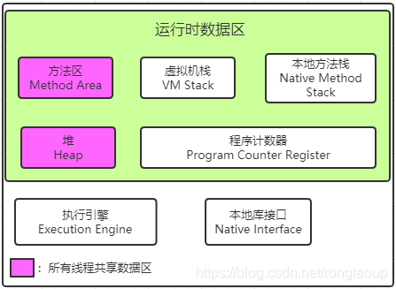
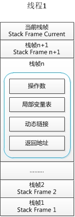
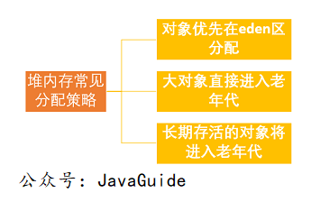
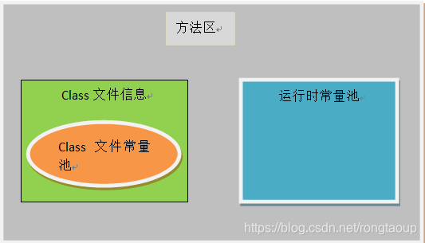
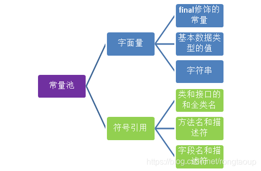
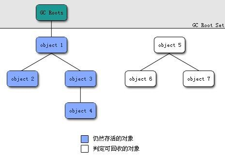
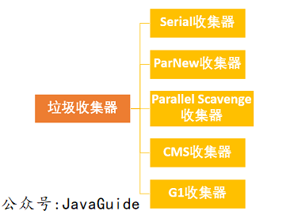
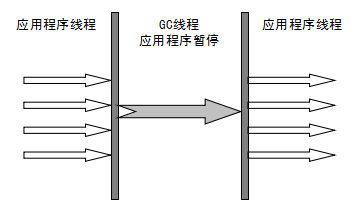
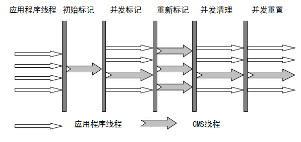
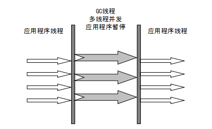

# JVM

> 本章按“运行时内存 → 类加载 → 对象生命周期 → 垃圾回收 → 并发内存语义 → 编译优化 → 参数工具 → 线上排障”组织。以 HotSpot 为主要讨论对象，对照 Java 8、Java 17，并说明 Java 21、23、24、25 的关键变化；收集器、默认值和诊断命令均应以目标 JVM 的版本、发行版与实际配置为准。
>
> **阅读提示**：JVM 运行时数据区回答“数据放在哪里”，JMM 回答“多线程怎样正确地观察和修改共享数据”，两者不是同一套划分。遇到线上卡顿，可直接阅读“八、常见 JVM 线上问题排查”。

## 版本阅读指南：Java 8、Java 17 与更高版本

本文中的 Java 8 / 17 等通常指对应 JDK 的 HotSpot 实现。**通用原理、首次引入、正式支持、默认启用和厂商回移是不同概念**。例如 Java 8 已有 G1，不代表它是常见 Server 配置的默认收集器。

### 1. 差异总表

| 主题 | Java 8 | Java 17 | 更高版本的关键变化 |
| --- | --- | --- | --- |
| 方法区实现 | 已移除永久代，使用元空间 | 仍为元空间，包含 JDK 16 的 Elastic Metaspace 改进 | 21 / 25 延续该方向，不是再次换了一种规范内存区域 |
| 字符串内部表示 | 常见为 `char[]` | JDK 9 起采用 Compact Strings：`byte[]` 配合编码标记 | 21 / 25 延续紧凑字符串思路，布局仍需核对构建 |
| 默认收集器 | 常见 HotSpot Server 配置为 Parallel；可选 CMS、G1 | 常见 HotSpot Server 配置为 G1；CMS 已移除 | 21 / 25 常见默认仍为 G1，不会因 ZGC 新功能自动改为 ZGC |
| G1 Full GC | 主线回退 Full GC 使用单线程实现 | 已包含 JDK 10 引入的并行 Full GC | 持续改进，但 Full GC 仍可能造成显著停顿 |
| ZGC | 标准主线 JDK 8 不自带 | 支持非分代 ZGC；可用性还受平台影响 | 21 可选分代；23 选择 ZGC 时默认分代；24 起移除非分代模式 |
| 类加载器 / 模块 | 扩展类加载器与传统 classpath，无 JPMS | 平台类加载器、JPMS、JDK 内部强封装 | 21 / 25 延续模块边界，旧反射与 Agent 需适配 |
| 偏向锁 | 常见实现默认启用，可能存在启动延迟 | 自 JDK 15 起默认禁用且弃用 | JDK 18 移除实现，旧选项不能照搬 |
| 线程模型 | 平台线程 | 平台线程，无正式虚拟线程 API | 21 正式支持虚拟线程；24 改善监视器相关 pinning |
| GC 日志 | `PrintGCDetails`、`Xloggc` 等旧式参数 | JDK 9+ 统一日志 `-Xlog` | 21 / 25 延续统一日志，标签与事件细节仍会演进 |
| JFR / jfr 工具 | 取决于厂商和更新号，部分 8u 构建有回移 | 完整 JDK 通常提供 JFR 与 `jfr` 工具 | 事件持续增加，虚拟线程等场景需匹配模板和工具 |
| 容器感知 | 早期 8 与较新 8u 差异大；常见从 8u191 起有相关支持 | 通常具备较完善支持，仍依更新号、平台和 cgroup 类型 | 不能仅凭高版本推断所有内核 / cgroup 情况都正确 |
| 对象头 | 常见传统布局，受压缩指针等配置影响 | 仍需考虑布局与配置差异 | 24 引入实验性紧凑对象头；25 转正但默认仍关闭 |
| `finalize()` | 存在，尚未像 JDK 9 起那样标记弃用 | 已弃用但仍存在 | JDK 18 起进一步标记为待移除，不能说 Java 17 已移除 |

以上以主线 HotSpot 和常见 Server 配置为基准，厂商可能回移功能。例如部分 Java 8 发行版带 JFR 或 Shenandoah，不能推广到所有 Java 8 构建。

### 2. 版本标注的阅读方式

- **[通用原理]**：区域的逻辑职责、可达性、类加载生命周期、JMM 等，在本文对照版本中具有连续性。
- **[Java 8] / [Java 17]**：对应版本的典型实现；Java 8 还必须看完整的 `8uXXX` 更新号。
- **[Java 21+]**：仅在注明从 21 引入并延续的范围使用，如正式虚拟线程，不代表 21 和 25 的所有实现细节相同。
- **[Java 24] / [Java 25]**：明确具体变化节点。本文更高版本重点列举 21、23、24、25，其他及后续版本应继续核对发行说明。

LTS 是厂商的长期维护策略，不表示不同 LTS 的 GC、参数和诊断输出保持不变。线上先记录完整版本、厂商、更新号、启动参数与收集器，再使用对应的排查步骤。

## 一、运行时数据区与内存边界

> **版本范围**：区域的逻辑职责为通用原理；元空间、字符串和对象布局分别标注 Java 8、17 及更高版本的实现差异。

### 1. 总体划分



| 区域 | 是否线程私有 | 主要内容 | 常见异常 / 关注点 |
| --- | --- | --- | --- |
| 程序计数器 | 是 | 当前线程执行字节码的位置 | JVM 规范未规定此区域的 OOM 情况 |
| Java 虚拟机栈 | 是 | 方法调用的栈帧 | `StackOverflowError`；创建线程等场景也可能因内存 / 系统资源不足失败 |
| 本地方法栈 | 是 | 为 Native 方法调用服务 | 与本地执行实现相关；HotSpot 中通常与虚拟机栈结合实现 |
| Java 堆 | 否 | 对象与数组的主要分配区域 | `Java heap space`、GC 压力、存活对象规模 |
| 方法区 | 否 | 类元数据、运行时常量池等逻辑内容 | 是规范概念，不等于某一种固定实现 |

堆之外还存在元空间、线程栈、Code Cache、直接内存、JVM / Native 库分配等开销。**`-Xmx` 是堆上限，不是 Java 进程内存上限；RSS、堆 used、已提交内存与保留地址空间也不是同一个指标。**

### 2. 程序计数器

程序计数器用于在分支、循环、异常处理及线程切换后确定字节码执行位置。每个线程独立维护，避免互相覆盖。执行 Java 方法时记录相关字节码指令位置；执行 Native 方法时，其值在规范中为未定义（undefined）。

### 3. Java 虚拟机栈与本地方法栈

每次方法调用通常对应一个栈帧的入栈，返回或异常退出对应出栈。Native 方法通常由 C / C++ 等实现，但“本地实现”不等于所有 Native 方法都直接执行系统调用。



| 栈帧组成 | 作用 |
| --- | --- |
| 局部变量表 | 存储参数、局部变量及对象引用；非静态方法的第 0 个槽通常是 `this` |
| 操作数栈 | 为字节码运算、参数传递等提供临时操作空间 |
| 动态链接 | 支持将运行时常量池中的符号引用关联到实际调用目标 |
| 方法返回相关信息 | 支持方法正常或异常退出后恢复调用者 |

局部变量表容量由编译结果中的 `max_locals` 描述，变量槽可复用，`long` / `double` 占两个槽；不要把槽的规范计数机械等同于所有机器上的固定物理字节布局。

递归过深、大栈帧可能导致 `StackOverflowError`；`-Xss` 影响线程栈大小。线程过多导致的 `unable to create native thread`，还要检查系统线程限制、容器 PID 限额和进程总内存，不能只增大堆。

**[Java 8 / 17 与 Java 21+]** 按 OS 线程计算本地栈开销的方式主要针对平台线程。Java 21 正式引入的虚拟线程使用堆中的栈块等结构，并挂载到承载线程运行；不能用“虚拟线程数 × 每个平台线程的 `-Xss` 本地预留”估算内存。承载线程仍有本地栈，虚拟线程也有堆内存和栈深度等约束。

### 4. 堆与分代布局

堆主要存放对象和数组，并由 GC 管理。JIT 可能消除不需要实际分配的对象，因此“源码出现 `new`”不代表一定产生对应的堆分配。

传统分代布局通常为年轻代与老年代，年轻代包含 Eden、两个交替使用的 Survivor 区。G1 保留分代语义，但以 Region 组织内存；其他收集器的布局也可能不同，不能把 Eden / Survivor 图当作所有 JVM 的统一物理结构。



### 5. 方法区、永久代、元空间与常量池



方法区是规范中的逻辑区域。HotSpot 在 JDK 7 及更早版本使用永久代承载相关内容；JDK 8 移除永久代，使用本地内存中的元空间保存类元数据。**元空间属于 JVM 管理的进程内存，也会受到类卸载及 GC 的影响，不是“在 JVM 外且不回收”。**

- `-XX:MetaspaceSize`：元数据使用触发相关 GC 的初始高水位，不应简单理解为“启动时就分配这么大的元空间”。
- `-XX:MaxMetaspaceSize`：限制元空间相关分配的上限；不限制整个进程的本地内存。
- 类加载器泄漏、动态生成大量类等可能导致元空间持续增长；增大上限不能消除引用泄漏。



| 名称 | 含义与区别 |
| --- | --- |
| Class 文件常量池 | 编译产物中的字面量、符号引用等，不是运行时的一块堆区域 |
| 运行时常量池 | 类 / 接口加载后维护的运行时结构，是方法区逻辑内容之一 |
| 字符串驻留池（StringTable） | 支持字符串字面量与 `String.intern()` 的规范化引用；HotSpot 的驻留字符串对象从 JDK 7 起存放在堆中 |
| 包装类缓存 | 如 `Integer.valueOf()` 的对象复用机制，不等同于运行时常量池 |

`"ab".intern()` 返回字符串池中与其内容相等的规范引用；不是每次都创建新字符串。移除永久代降低了固定容量管理的负担，但不意味着不再出现元数据内存问题。

**[Java 8 → Java 17]** 两者都使用元空间，区别不是“8 有永久代、17 才有元空间”。Java 17 包含 JDK 16 的 Elastic Metaspace（JEP 387），改善元数据内存组织与类卸载后的内存归还；它不能自动消除类加载器泄漏。

**[Java 8 → Java 17 / 21 / 25]** 常见字符串内部存储从 `char[]` 改为 `byte[]` 加编码标记（JDK 9，JEP 254），不是所有字符都压成单字节。升级后 histogram 中 `char[]` / `byte[]` 比例变化可能来自实现改变，不能直接当作泄漏增减；字符串 API 和字符串池语义也不等同于内部数组表示。

## 二、类加载过程与类加载器

### 1. 类的生命周期


验证、准备、解析合称连接。图用于理解逻辑阶段；解析可以延迟，部分阶段可以交叉，不应理解为所有类始终严格按图一次性执行完毕。

### 2. 加载、验证、准备与解析

| 阶段 | 核心工作 | 易混淆点 |
| --- | --- | --- |
| 加载 | 获取类的二进制表示，建立运行时结构及 `Class` 对象 | 字节流可来自 JAR、网络、动态生成等；数组类由 JVM 创建 |
| 验证 | 检查文件格式、元数据、字节码及符号引用等合法性 | 类文件格式正确，不代表业务逻辑正确 |
| 准备 | 为静态字段建立存储并设置初始值 | 普通静态变量先取零值；带 `ConstantValue` 的静态常量有特殊处理 |
| 解析 | 将符号引用解析为可使用的运行时引用 | 目标可能是类、字段、方法等，不应全部简化为固定的方法表偏移 |

例如 `static int value = 111`，准备时通常为 `0`，初始化时再赋为 `111`；`static final int VALUE = 111` 可使用常量值属性处理。并非所有 `static final` 都是编译期常量，如 `static final Integer VALUE = 111` 或 `static final int VALUE = readConfig()`。

在现代 HotSpot 中，类元数据与静态字段值的实际存储位置还要区分；不能由“准备是连接阶段”推出所有静态字段都物理存放在元空间。

### 3. 初始化与主动使用

初始化执行类初始化逻辑，通常由编译器将静态字段初始化和静态代码块组合为 `<clinit>`。JVM 负责协调同一个类的并发初始化；静态初始化中执行阻塞 I/O、等待其他类或循环依赖，可能造成长时间等待甚至初始化死锁。

常见触发场景包括创建实例、访问需初始化的静态字段、调用静态方法、要求初始化的反射操作、初始化子类前先初始化父类，以及启动主类。方法句柄的相关主动使用、实现类初始化时对声明默认方法的相关父接口初始化，也有相应规范规则。

读取编译期常量、创建某类型的数组、`ClassLoader.loadClass()`，通常不等于初始化该类型；`Class.forName(name, false, loader)` 也可只加载而不初始化。不能把“任何反射 / 方法句柄操作都立即初始化”当作通则。

### 4. 双亲委派及其边界

JDK 8 常见为启动、扩展、应用类加载器；JDK 9+ 调整为启动、平台、应用类加载器，并引入模块体系，不能把旧版扩展目录规则直接套用到新版。

经典 `ClassLoader.loadClass()` 的思路如下，属于流程伪代码：

```text
取得对应类名的加载锁
    若已加载，返回已有 Class
    否则先委派父加载器（或尝试启动类加载器）
    父加载器找不到时，再调用自己的 findClass
    按需执行 resolveClass
```

双亲委派有利于共享核心类型和减少重复定义，但类的身份仍由**二进制类名 + 定义它的类加载器**共同决定。它也不是唯一的安全机制，核心包保护和模块访问控制等有独立作用。

通常自定义字节码来源重写 `findClass()` 即可保留父委派；需要容器 / 插件的特殊隔离策略时才谨慎调整 `loadClass()`，并处理并发加载、共享 API 与核心类的委派规则。

SPI 还会涉及线程上下文类加载器（TCCL）：它允许框架从应用 / 插件加载器的视角寻找实现，并不意味着取消父委派。对应机制见 [Java 其他：SPI](java/other)。

### 5. Java 8 迁移到 Java 17 及更高版本的边界

- **Java 8**：常见应用类加载器基于 `URLClassLoader`，旧扩展机制和较宽松的 JDK 内部访问在存量代码中较常见。
- **Java 9+ / Java 17**：平台类加载器替代扩展类加载器，旧 `java.ext.dirs` 机制不再适用；不要强转应用加载器为 `URLClassLoader`。classpath 仍可使用，升级不要求立即将所有业务代码改为命名模块。
- **Java 17**：JDK 内部强封装（JEP 403）使旧反射、字节码工具和 Agent 可能出现访问异常；不能靠旧 `--illegal-access` 恢复之前的放宽策略。优先升级依赖，确需开放时评估范围明确的 `--add-opens` / `--add-exports`。
- **Java 21 / 25**：继续遵守模块边界；还需确认 Agent、ASM、JOL、MAT 等工具能识别目标版本的类文件或对象布局。

Java 8、17、21、25 的类文件主版本号分别为 52、61、65、69，低版本 JVM 不能直接运行高版本编译产物。使用 `--release 8` 等控制编译目标时，还需保证依赖兼容，并区分编译目标与实际运行 JVM。

## 三、对象的创建、存活与回收依据

### 1. new 一个对象发生了什么

1. 确保目标类已经完成所需的加载、连接与初始化。
2. 为对象分配内存；HotSpot 常结合 TLAB、指针碰撞或空闲列表等机制，具体取决于收集器与布局。
3. 对实例字段进行默认零值初始化，设置对象头等必要信息。
4. 按 Java 初始化规则执行父类构造、当前类实例字段 / 初始化块及构造器主体等逻辑。
5. 将对象引用交给调用方；引用之后放在局部变量、其他对象字段还是静态字段，取决于程序。

对象大小可概括为“对象头 + 实例字段（包含继承字段）+ 对齐填充”，数组另有长度等信息。压缩指针、对象头方案、字段布局与对齐参数都会改变结果，不能仅按源码字段顺序相加；必要时结合 JOL 或实际分配分析。

**[Java 24 / 25]** 紧凑对象头在 JDK 24 实验性引入（JEP 450），JDK 25 转为正式特性（JEP 519），但 **Java 25 默认仍未开启**。支持的构建可评估 `-XX:+UseCompactObjectHeaders`；不要给 Java 8 / 17 添加此参数，也不要把“高版本对象头一定是 8 字节”写成固定结论。

### 2. 分配与晋升策略

- 传统分代收集器中，普通对象通常先在年轻代分配；Eden 空间不足可能触发年轻代回收。
- 对象经过回收仍存活且能放入 Survivor，年龄会增长；达到阈值或满足动态年龄等条件时可能晋升老年代。`MaxTenuringThreshold` 是相关上限参数，不代表每个对象固定活到 15 次才晋升。
- 大对象的处理取决于收集器和参数。“大对象总是直接进老年代”并非通则；G1 中超过 Region 一半大小的对象按 Humongous 对象特殊处理，需要关注连续 Region 与空间占用。
- 晋升 / 复制失败、回收启动不及时等可能导致更重的回收，具体由目标收集器决定。

### 3. 引用计数与可达性分析

引用计数法为对象维护引用数量，实现直观，但简单实现难以处理循环引用。HotSpot 的主要垃圾回收机制采用可达性分析，而不是靠引用计数判断所有对象生死。

可达性分析从 GC Roots 沿引用关系查找可达对象。常见根来源包括线程栈中的活跃引用、JNI 引用、静态字段相关引用及 JVM 内部保持的引用等；具体根处理与收集器实现有关。



GC 判断的是可达性，不是业务上“是否还会使用”。无限增长的缓存、未移除的监听器、线程池中未清理的 `ThreadLocal`、长期积压的任务，都可能保持业务已不需要的对象，这就是常见内存泄漏来源。

### 4. 强、软、弱、虚引用

| 引用 | 主要语义 | 工程注意点 |
| --- | --- | --- |
| 强引用 | 只要通过强引用链可达，通常不能作为垃圾回收 | 不再使用时需消除无意义的长期持有 |
| 软引用 | 内存压力下可被回收，回收时机由实现策略决定 | 不等于可靠的容量控制；业务缓存通常应明确上限与淘汰策略 |
| 弱引用 | 只弱可达时可在相关 GC 中被清理 | 常配合 `ReferenceQueue`，不能假设创建后固定多久就失效 |
| 虚引用 | `get()` 返回 `null`，配合队列跟踪清理相关通知 | 不应通过它读取对象，入队不等于外部资源已自动释放 |

`ReferenceQueue` 用于接收相关引用通知，应用仍需处理自己的清理协议。不要把软引用当作“加速 GC、防止一切 OOM”的开关。

原有 `finalize()` 与对象复活属于历史知识：它不保证及时执行，有性能与正确性风险。**[版本区别]** Java 8 中存在；JDK 9 开始弃用，因此 Java 17 中已弃用但仍存在；JDK 18 再通过 JEP 421 将 Finalization 标记为待移除，不能将弃用写成已经移除。不能用“所有对象回收前必经两次标记”描述现代 GC；资源释放优先使用 `try-with-resources` 等明确的生命周期管理。

### 5. 类卸载与元空间回收

普通类卸载与定义它的类加载器是否仍然可达密切相关。实例、`Class` 对象、静态引用、线程上下文加载器等形成的引用链，都可能使相关加载器继续存活。

可卸载并不代表立即卸载，实际时机与 GC 和配置有关；不能要求“加载器必须先被单独回收，类才能回收”这样的严格顺序。观察元空间异常时，应同时看已加载 / 已卸载类数量、动态代理生成、热部署残留及类加载器引用链。

## 四、垃圾回收：算法、收集器与 Full GC

> **版本范围**：算法是通用思路，收集器实现并非跨版本等价。Java 8 常见 Parallel / CMS / G1，Java 17 常见 G1；Java 21 / 23 / 24 的 ZGC 模式另见本节版本线。

### 1. 回收算法

| 算法 / 思路 | 基本过程 | 优点 | 主要代价 |
| --- | --- | --- | --- |
| 标记-清除 | 标记存活对象，回收其余空间 | 不要求移动所有存活对象 | 可能产生碎片，分配与遍历开销需考虑 |
| 标记-复制 | 将存活对象复制到目标空间，释放原区域 | 回收后空间规整，存活对象少时高效 | 需要目标空间，存活率高时复制成本大 |
| 标记-整理 | 标记后移动存活对象、整理连续空间 | 减少碎片 | 移动和更新引用有成本 |
| 分代收集 | 按对象存活特征采用不同回收策略 | 利用多数对象朝生夕死的经验 | 需维护跨代引用，不能作为所有收集器的统一实现假设 |

分代是组织策略，不是与前三者互斥的单一算法。现代收集器通常组合多种技术。

### 2. STW、并行、并发与安全点

**STW（Stop-The-World）**表示某个阶段暂停应用线程。并行指多个 GC 线程一起工作，并发指部分 GC 工作与应用执行交叠；并发收集器也可能有 STW 阶段。

安全点用于让相关线程在适合观察运行时状态的位置协调暂停。线上总卡顿时间可能包含“等待线程到达安全点”与“安全点内执行操作”的时间，因此“请求超时”不一定完全等于 GC 日志中的回收耗时。

### 3. 收集器及版本适用范围



| 收集器 | 主要特点 | 适用范围 / 局限 |
| --- | --- | --- |
| Serial / Serial Old | 单 GC 线程；年轻代复制、老年代整理 | 资源较少的小应用可考虑，暂停影响明显 |
| ParNew + CMS | 年轻代并行回收，老年代以并发标记-清除为主 | 典型 JDK 8 历史组合；CMS 在 JDK 14 移除，不适用于 JDK 17 / 21 |
| Parallel Scavenge + Parallel Old | 多线程 STW 回收，偏重吞吐量 | 常见于 JDK 8 Server 配置；不代表所有发行版与环境默认都一样 |
| G1 | Region 化、分代、并发标记、复制回收，面向停顿目标 | JDK 9 起常见 HotSpot Server 默认；停顿目标不是硬实时保证 |
| ZGC / Shenandoah | 以低停顿为目标，将更多工作并发化 | 可用性、分代能力及参数依 JDK 与发行版而变，仍需 CPU 和内存余量 |

**Serial / Serial Old**：实现相对简单，不存在多 GC 线程协调成本；老年代单线程整理可能造成较长停顿。



**ParNew 与 CMS（历史）**：ParNew 负责年轻代。CMS 主要阶段为初始标记（STW）、并发标记、重新标记（STW）、并发清除；优点是降低老年代回收停顿，代价包括 CPU 竞争、浮动垃圾和碎片。




**Parallel**：优先关注吞吐量，可结合自适应策略；较大的吞吐量不意味着满足请求尾延迟目标。现代对应版本通常使用 `-XX:+UseParallelGC` 选择整套收集器，不应照搬旧版组合参数。



### 4. G1 的 Region、RSet 与回收阶段

G1 将堆划成大小相等的 Region，按角色组织 Eden、Survivor、Old 及 Humongous 等区域，角色可变化。Region 大小由 JVM 选择或通过 `G1HeapRegionSize` 配置；不要将 Region 数量视为固定值。

为了避免每次年轻代回收都扫描整个老年代，收集器使用写屏障及卡表等维护跨区域引用信息。G1 的 Remembered Set（RSet）帮助定位指向待回收区域的外部引用；它也有维护与扫描成本，不是可以忽略的免费索引。

常见过程包括年轻代疏散回收、并发标记及其必要的 STW 阶段、混合回收。Mixed GC 会回收年轻代与选定老年代 Region，并不等同于 Full GC。G1 发生复制空间不足等严重情况时，可能退化为 Full GC。

**[Java 8 与 Java 17 的关键区别]** Java 8 主线 G1 的回退 Full GC 通常使用单线程；JDK 10 的 JEP 307 引入 G1 并行 Full GC，Java 17 / 21 / 25 已包含该改进。这改善最坏情况下的回收能力，但不保证升级后没有 Full GC，也不能将 Java 8 的暂停时长作为升级后的固定预期。

`-XX:MaxGCPauseMillis` 是软目标。手动固定过大的年轻代或盲目调整 Region，可能破坏自适应行为，应结合分配速率、存活规模、疏散成本与实际日志验证。JDK 21 的 ZGC 可选分代模式与 G1 机制不同，也不能复用整套 G1 调优参数。

### 5. Minor、Major、Mixed、Full GC 怎样区分

| 术语 | 常见含义 | 需要避免的误解 |
| --- | --- | --- |
| Minor / Young GC | 年轻代回收 | 次数多不一定异常，要结合分配速率和停顿 |
| Major GC | 有时指老年代回收，有时被工具混用 | 不是跨所有收集器严格一致的事件名 |
| Mixed GC | G1 回收年轻代和选定老年代 Region | 不等于整堆 Full GC |
| Full GC | 通常指范围广、停顿较重的全堆回收事件 | 是否及如何处理元数据取决于实现，不能只凭“老年代下降”认定发生过 Full GC |
| Concurrent Cycle | 并发标记 / 回收周期等 | 不等于一次全程 STW，也不能直接计入 Full GC 次数 |

最终以目标收集器的 GC 日志事件与原因确认。“Major GC 固定比 Minor GC 慢十倍”没有通用依据。

### 6. 常见 Full GC 诱因

- **老年代 / 复制目标空间不足**：高存活量、晋升压力、突发分配、回收启动过迟等。应区分正常容量需求、积压和泄漏。
- **大对象与碎片**：历史 CMS 的碎片，或 G1 Humongous 分配及连续 Region 问题；不是看到“堆没满”就一定不会分配失败。
- **显式 GC 请求**：业务代码、库、工具或某些 RMI 路径可能请求 `System.gc()`，具体是否 Full GC 由收集器及配置决定。不要假定所有应用都会固定每小时发生一次。
- **元数据分配压力**：元空间扩展、类加载器长期存活等可能触发相关 GC；JDK 8+ 应检查 Metaspace，而不是调整 PermGen。
- **历史 CMS 失败**：`promotion failed`、`concurrent mode failure` 等需按旧版收集器定位。旧式晋升担保策略与参数也有版本差异，不能作为所有 JDK 的固定触发公式。

`-XX:+DisableExplicitGC` 可能屏蔽部分显式请求，但会改变依赖相关清理路径的行为，应先查调用来源。部分收集器可用 `ExplicitGCInvokesConcurrent` 等策略，均需确认版本与验证效果；不能把开关当作内存泄漏修复。

### 7. ZGC 与低停顿收集器的版本线

下表只讨论**已经选择 ZGC 后的模式**，不是说该版本 JVM 的默认收集器改为 ZGC。

| 版本 | ZGC 状态 / 模式 | 典型启动参数（需平台支持） |
| --- | --- | --- |
| Java 8 | 标准主线不提供 ZGC | 不应添加 `UseZGC` |
| Java 17 | ZGC 在 JDK 11 实验性引入、15 转正；17 使用非分代模式 | `-XX:+UseZGC` |
| Java 21 / 22 | 新增可选分代 ZGC（JEP 439），单独选择 ZGC 时默认仍为非分代 | 分代模式：`-XX:+UseZGC -XX:+ZGenerational` |
| Java 23 | 选择 ZGC 时默认改用分代模式（JEP 474） | `-XX:+UseZGC` 即可使用分代模式 |
| Java 24 / 25 | 移除非分代模式（JEP 490） | 使用 `-XX:+UseZGC`，不把旧模式切换参数当作必需配置 |

Java 17 不能照搬 Java 21 的 `ZGenerational` 参数。G1 的 Region、Mixed GC、晋升阈值及 Full GC 事件，也不能直接套为 ZGC 的实现与监控口径；ZGC 要结合自身周期、分配停顿及目标版本事件分析。

Shenandoah 与 ZGC 是不同收集器。发行版是否编译提供 Shenandoah、是否带厂商回移及该版本的分代能力，都需独立确认，不用 ZGC 的支持情况推断。

## 五、Java 内存模型（JMM）

> **[Java 8 / 17 / 21 / 25 通用]** 本节的可见性、原子性、先行发生和安全发布原则持续适用。新同步实现或 Java 9 起的 VarHandle 等 API，并未将 JMM 改成另一套堆 / 栈分区。

### 1. JMM 关注可见性、原子性和有序性

JMM 定义多线程读写共享变量时允许观察到的结果，屏蔽硬件与编译器差异。它不把内存重新划成“堆区和线程栈区”，也不保证两个线程访问同一字段时各自拥有一份按固定时刻同步的物理副本。

“主内存 / 工作内存”是解释交互的抽象，不应机械等同于主存 / CPU 缓存。发生数据竞争时，普通读写可能观察到旧值或重排序结果；`i++` 这样的读-改-写也不因字段声明为 `volatile` 就整体原子。

### 2. happens-before 与安全发布

| 规则 / 工具 | 保证与边界 |
| --- | --- |
| 程序次序规则 | 同一线程内的语义顺序形成相应先行关系，并不禁止所有底层重排 |
| 监视器解锁 / 加锁 | 对同一监视器的释放先行于后续获取，配合互斥保护复合不变量 |
| `volatile` 写 / 读 | 对同一变量的写与后续读建立相应可见性和排序关系，不等于所有代码都串行执行 |
| `Thread.start()` / `join()` | 启动前的相关写可发布给被启动线程；成功等待结束后可见其结果 |
| 传递性 | A 先行于 B，B 先行于 C，则 A 先行于 C |
| `final` 字段语义 | 正确构造且避免构造期间 `this` 逃逸时有特殊可见性保证；不表示对象所有后续操作都线程安全 |

安全发布通常依靠锁、`volatile`、静态初始化或并发容器等明确协议。不要用“每次直接读物理主存”替代对 `volatile` 的语义理解。

### 3. 传统八种交互操作如何理解

原有笔记中的八种操作可作为历史抽象保留，但不是线上诊断中的八条真实 CPU 指令：

| 操作 | 抽象含义 |
| --- | --- |
| `lock` / `unlock` | 变量锁定与释放的历史模型描述 |
| `read` / `load` | 将主内存值传向工作内存并装载 |
| `use` / `assign` | 执行引擎使用值或给变量赋值 |
| `store` / `write` | 将工作内存值传回主内存并写入 |

理解它们的成对与顺序约束有助于阅读旧资料；工程正确性应依据现代 JLS 的同步、先行发生与数据竞争规则，不能据此断言某次普通字段读写必然执行一套特定缓存刷新操作。更多并发内容见 [多线程](java/multiThread)。

## 六、JIT 与逃逸分析

### 1. 执行引擎与分析目标

HotSpot 通常结合解释执行、分层编译与 JIT 优化，热点代码可能经历内联、逃逸分析、锁消除与标量替换。逃逸分析用于判断对象的引用是否离开可分析范围，并不保证某个源码模式一定触发优化。

分析可通过引用关系 / 连接图等方式推导对象传播，精度与成本需要折中；具体算法和优化能力与 JIT 实现有关，不能把某篇论文的算法当作所有 HotSpot 版本逐项不变的实现。

### 2. 逃逸状态与优化

| 状态 / 优化 | 含义 |
| --- | --- |
| 全局逃逸（GlobalEscape） | 对象可能经静态字段、其他逃逸对象等途径被更广范围访问 |
| 参数逃逸（ArgEscape） | 通过调用参数传播，是否进一步逃逸取决于调用分析与内联结果 |
| 不逃逸（NoEscape） | 在当前可分析范围内未发现逃逸 |
| 锁消除 | 能证明相关同步无需跨线程协调时，可去掉部分锁操作 |
| 标量替换 / 分配消除 | 对象可拆成字段值，可能不再实际分配完整对象 |

对 HotSpot 常见的 `DoEscapeAnalysis`、`EliminateLocks`、`EliminateAllocations` 参数，应通过目标 JVM 的参数输出确认。`PrintEscapeAnalysis`、`PrintEliminateAllocations` 在常见产品构建中属于不可直接使用的调试选项，不能作为通用线上命令。

### 3. “栈上分配”的准确边界

标量替换后，部分字段值可能存在寄存器或栈上，但这不等于 HotSpot 普遍把完整对象搬到栈上。更准确的描述是：**某些对象分配可以被 JIT 消除**，而不是“所有不逃逸对象一定栈上分配”。

原有 `return sb` 改成 `return sb.toString()` 的例子还会改变返回类型和语义，不能为了优化机械替换。先保持业务契约，再用分配剖析、JFR 或基准验证实际收益。

### 4. 锁优化的版本边界

- **Java 8**：常见锁实现说明涉及偏向锁、轻量级锁与监视器等历史路径，具体仍依参数和运行状态。
- **Java 17**：JDK 15 已默认禁用并弃用偏向锁（JEP 374），不能说默认先经历偏向锁。
- **Java 18 及以后**：偏向锁实现被移除，相关旧选项有各自的废弃 / 移除周期。Java 21 / 25 不应照搬 `UseBiasedLocking`、`BiasedLockingStartupDelay` 等配置。

这不改变 `synchronized` 的互斥和内存语义，也不表示不再有锁竞争、膨胀与锁消除。Java 24 的虚拟线程监视器及 pinning 变化见排障部分，不能将 Java 8 的锁升级图视为所有更高版本的完整实现。

## 七、常用参数、日志与诊断工具

### 1. 参数按问题选择

| 目标 | 常见参数 | 需要确认的边界 |
| --- | --- | --- |
| 堆容量 | `-Xms`、`-Xmx` | 给线程栈、元空间、直接内存、Native 库及容器余量留空间 |
| 线程栈 | `-Xss` | 过小易栈溢出，过大叠加高线程数消耗本地内存 |
| 元空间 | `-XX:MetaspaceSize`、`-XX:MaxMetaspaceSize` | 高水位与上限不同，先排查类加载器与类数量趋势 |
| OOM 现场 | `-XX:+HeapDumpOnOutOfMemoryError`、`-XX:HeapDumpPath=/var/log/app` | 需可写目录和磁盘空间；OS 直接杀进程时未必有机会生成 |
| 本地内存跟踪 | `-XX:NativeMemoryTracking=summary` | 需启动时启用，有额外开销，也不涵盖所有第三方 Native 分配 |
| 收集器 | `UseG1GC`、`UseParallelGC`、`UseZGC` 等 | 支持范围和组合依版本，不能只改开关就认为完成调优 |

诊断命令优先使用与目标 JVM 匹配的 JDK 工具，先查看 `jcmd <pid> help` 及具体命令帮助。精简 JRE 镜像可能不带工具，Attach、PerfData、用户身份及 PID / 挂载命名空间都会影响可用性。

### 2. GC 日志：JDK 8 与 JDK 9+

以下为**启动参数示例**，不是直接粘贴到 shell 执行的命令；目录应提前创建并具备权限。

```text
# JDK 8 HotSpot 常见配置
-XX:+PrintGCDetails -XX:+PrintGCDateStamps -XX:+PrintGCApplicationStoppedTime
-Xloggc:/var/log/app/gc.log
-XX:+UseGCLogFileRotation -XX:NumberOfGCLogFiles=5 -XX:GCLogFileSize=20M

# JDK 9+ 统一日志；适用于常见 JDK 17 / 21 / 25
-Xlog:gc*,safepoint:file=/var/log/app/gc.log:time,uptime,level,tags:filecount=5,filesize=20M
```

统一日志的标签可用 `java -Xlog:help` 检查。日志要同时保留可关联业务的时间、JVM uptime、GC 类型、原因、暂停时间和回收前后占用，并做轮转；分析时校准应用、主机、监控与数据库的时钟 / 时区。

**[Java 8 → Java 17 / 21 / 25]** 不要原样带入 `PrintGCDateStamps`、`UseGCLogFileRotation` 等整套旧参数，其中部分在新版本不再接受；应迁移为统一日志配置，Java 8 也不能直接用 `-Xlog:gc*`。日志解析器和告警规则需同步迁移；Java 8 示例中的 `PrintGCApplicationStoppedTime` 记录应用暂停相关信息，不表示每次暂停都由 GC 引起。

### 3. 工具与操作影响

| 工具 / 操作 | 主要用途 | 线上注意点 |
| --- | --- | --- |
| `jcmd -l`、`jps -lv` | 识别 Java 进程 | 容器或权限隔离下可能不完整，结合系统进程确认 |
| `jcmd ... VM.flags`、`VM.version` | 确认版本与实际参数 | 先看事实，避免按默认收集器推断 |
| `jcmd ... Thread.print -l`、`jstack -l` | 获取线程栈、监视器与同步器信息 | 输出量和协调成本随线程规模变化，应适度多次采样 |
| `jstat` | 按间隔看 GC / 内存计数 | 有版本与收集器差异，不能替代 GC 日志 |
| `jcmd ... GC.heap_info` | 堆及相关区域概况 | 影响依堆规模与实现，不等于零成本 |
| JFR | 连续观察 CPU、分配、锁等待、I/O 等事件 | JDK 17 / 21 常用；事件配置、阈值与开销需要确认 |
| `GC.class_histogram`、堆转储 | 分析对象数量、大小和引用关系 | 可能有明显停顿；默认活对象统计 / 转储可能请求 Full GC，必须看帮助并评估 |

`jmap` 是常见旧工具，但现代 HotSpot 优先考虑 `jcmd`；`jhat` 自 JDK 9 已移除，离线分析可使用 Eclipse MAT 等工具。不要在事故初期无差别执行堆转储、`jmap -histo:live` 或 `GC.run`，它们可能改变现场并增加暂停。

### 4. 线上工具命令的版本兼容表

| 工具 / 能力 | Java 8 | Java 17 | Java 21 / 25 |
| --- | --- | --- | --- |
| `jcmd`、`jstack`、`jstat` | 常见完整 JDK 已有，命令与列定义依 8u 构建 | 常见可用，先看目标进程 `help` | 同样先查帮助，尤其线程模型与新收集器 |
| `GC.heap_info` | 不假定所有 8u 都提供；不支持时先用 `jstat -gc` 等 | 常见支持 | 常见支持，输出随收集器变化 |
| 线程转储 | `Thread.print -l` / `jstack -l` 面向平台线程 | 同样按平台线程分析 | 虚拟线程需结合 `Thread.dump_to_file` 等，传统输出覆盖不同 |
| JFR | 老 Oracle JDK 8 与 OpenJDK 回移版有差异，部分 8u262 起构建包含回移 | 主线已集成，完整 JDK 通常可用 | 增加虚拟线程等事件，模板仍依版本 |
| `jfr summary / print` | 不保证自带该命令，不能直接套现代工具链 | 完整 JDK 通常可用 | 通常可用，旧分析器未必识别新内容 |
| NMT | HotSpot 有相关跟踪，需启动时启用并看构建支持 | 同样需提前开启 | 同样需提前开启，分类和覆盖会演进 |
| `jhat` | 历史 JDK 工具，能力有限 | JDK 9 已移除，使用兼容的 MAT 等 | 同 Java 17 |
| 虚拟线程 TID 映射 | 不涉及正式虚拟线程 | 不涉及正式虚拟线程 | 不能把每个虚拟线程映射为一个 OS TID |

JFR 在 JDK 11 通过 JEP 328 纳入 OpenJDK；Java 8 需检查发行版、更新号与配置 / 使用条件。例如 Red Hat 的部分 OpenJDK 8 构建从 8u262 起提供回移，不能推广到所有 Java 8。不要给所有 Java 8 统一添加旧商业功能解锁参数，也不要把现代 JFR 命令成功视为已验证 Java 8。

## 八、常见 JVM 线上问题排查

> 本节面向 Linux 服务器 / 容器上的 HotSpot 平台线程，命令示例使用 Bash；Windows 的 `top`、`ps`、信号与 `/proc` 命令不适用。`jcmd` 等 JDK 命令可按平台调整路径。以下 PID、目录、Pod 名均需替换为实际值，诊断对象应是已确认的业务 JVM。

> **版本约定**：证据分析思路适用于 Java 8 / 17 / 更高版本，命令参数主要以 Java 17 / 21 为示例。Java 8 先核对工具兼容表，Java 21+ 虚拟线程和 Java 24 pinning 改动见 3.4，不能将所有命令直接套用到全部版本。

### 1. 通用顺序：影响范围 → 时间线 → 证据 → 止血 → 验证

1. **确认影响**：是单实例、单接口、单机还是整个集群？记录开始时间、QPS、P95 / P99、错误率、超时、发布及流量变化。
2. **区分资源方向**：CPU 高还是低，RSS / 容器内存是否逼近限制，GC 暂停是否同时增加，线程池 / 连接池是否排队，下游是否变慢。
3. **先保留可关联的轻量现场**：版本、参数、GC 时间序列、数份线程快照、业务与依赖指标。单张截图或单份栈不够判断持续性。
4. **按证据止血**：限流、暂停异常任务、摘除实例或回滚；需要重启时先尽量保留必要现场，避免重启后只剩猜测。
5. **验证恢复与根因**：看队列是否下降、尾延迟和 GC 是否恢复，复现并验证修复；监控改善不代表泄漏或死锁已被永久修复。

先为采集设置变量，后文命令沿用这些变量：

```bash
jcmd -l
# 从进程信息中确认目标，不直接复制未核实的 PID
JAVA_PID=12345
DIAG_DIR=/var/log/app/diag-$(date +%Y%m%d-%H%M%S)
mkdir -p "$DIAG_DIR"

jcmd "$JAVA_PID" VM.version
jcmd "$JAVA_PID" VM.flags
jcmd "$JAVA_PID" help
```

采集目录需要可写且有容量；命令行、线程栈、JFR 与 heap dump 可能含业务或认证数据，应按生产诊断资料管理。容器内外 PID 可能不同，优先在匹配的用户与命名空间中执行，不要盲目用宿主机 PID 进入容器工具。

### 2. 应关注哪些监控

| 层面 | 核心指标 | 主要用来判断什么 |
| --- | --- | --- |
| 业务 | QPS、P95 / P99、失败 / 超时、在途请求、重试量 | GC / 阻塞是否真正影响业务，重试是否放大压力 |
| 进程 / 容器 CPU | CPU 使用率、配额、节流时间、运行队列 | 是代码热点、GC 消耗，还是配额不足导致实际调度时间不够 |
| 主机 | load、可运行 / 不可中断任务、iowait、磁盘延迟、swap、网络 | 高 load 不一定等于 Java CPU 高；换页和 I/O 也会拖慢 JVM |
| 进程 / 容器内存 | RSS、容器 current / limit、OOMKilled、系统余量 | 是否存在堆外增长、容器杀进程或节点内存压力 |
| JVM 内存 | 各池 used / committed / max、回收后存活量、Metaspace、Direct / Mapped Buffer | 分配压力、存活集增长、类加载问题与堆外问题 |
| GC / 安全点 | 暂停分布与最大值、次数 / 原因、Full GC 时间、并发周期、到达安全点耗时 | 区分少量长暂停、频繁回收、并发周期和非 GC 安全点 |
| 线程 | live / peak、各状态数量、死锁、线程数增长、线程 CPU、锁等待时间 | 锁竞争、热点、线程泄漏；`BLOCKED` 数量只覆盖特定监视器等待 |
| 线程池 | active、pool / max、队列长度与等待时间、完成速率、拒绝数 | 吞吐下降是否使任务持续堆积、是否存在饥饿 |
| 连接池 / 下游 | active / idle / pending、获取连接耗时、SQL / RPC 耗时、超时 | 卡顿是否来自数据库、远程依赖或资源池耗尽 |

Micrometer / Prometheus 常见指标族包括 `jvm_memory_used_bytes`、`jvm_threads_states_threads`、`jvm_gc_pause_seconds_*`，但具体名称、标签及直方图桶由版本和配置决定。Full GC 告警应结合收集器事件，不能把某个 `action` 标签无条件当作所有 JVM 的统一含义。

计数器看区间增量或速率，并处理实例重启导致的归零。暂停总时长 / 观察窗口可反映应用停顿占比，但并发 GC 的 CPU 时间或总周期时间不能直接当作 STW 时间。阈值应结合业务 SLO 和正常基线，不应只设“堆使用率超过 80%”或“线程处于 WAITING”这样的单点判断。

### 3. 线程 block：先分清是哪一种等待

| 线程表现 | 常见含义 | 下一步 |
| --- | --- | --- |
| `BLOCKED (on object monitor)` | 正在等待进入 / 重入 `synchronized` 监视器 | 找同一监视器的持有者及其正在执行的代码 |
| `WAITING` / `TIMED_WAITING` + `LockSupport.park` | AQS 锁、条件、队列、Future 等等待 | 看调用链与 ownable synchronizer 信息，确认等待对象和预期唤醒路径 |
| `Object.wait()` / 条件等待 | 等待某个条件，`wait()` 已释放对应监视器 | 看谁应改变条件和通知；不要把它当成一直持有该监视器 |
| `RUNNABLE` + socket / 文件 Native 调用 | 可能正在 I/O 等待，不一定消耗 CPU | 联查线程 CPU、下游延迟、超时和连接池 |
| 线程池工作线程等待取任务 | 可能是正常空闲 | 看 active、队列与完成速率，不能仅按状态判故障 |

Java 的 `BLOCKED` 专指监视器进入相关等待，**不涵盖所有业务阻塞**；`ReentrantLock`、连接池、`Future.get()` 等经常表现为 parking，而非 `BLOCKED`。

#### 3.1 连续获取几份线程快照

```bash
for i in 1 2 3; do
  date -Ins > "$DIAG_DIR/threads-$i.time"
  jcmd "$JAVA_PID" Thread.print -l > "$DIAG_DIR/threads-$i.txt"
  sleep 5
done

# 没有可用的 Thread.print 时，可按环境使用以下替代命令
jstack -l "$JAVA_PID" > "$DIAG_DIR/jstack.txt"
```

同一事故窗口间隔数秒获取多份，判断线程是否持续停在相同调用点、完成请求的线程是否流动、等待范围是否扩大。线程很多时应评估输出与采样开销，不能高频无限抓取。

在 Linux HotSpot 中，`kill -3 "$JAVA_PID"` 通常可请求线程转储，输出到目标进程标准错误相关日志；受 `-Xrs`、信号处理与日志配置等影响。它是 SIGQUIT，不是强制结束命令，使用前要确认进程与日志去向；不能用 `kill -9` 获取线程现场。

#### 3.2 沿“等待者 → 锁 → 持有者”分析

下面是简化示意，不是必须与某个 JDK 格式逐字一致的真实转储：

```text
"http-worker-17" ... nid=0x4a10 waiting for monitor entry
  java.lang.Thread.State: BLOCKED (on object monitor)
    at com.example.OrderService.handle(OrderService.java:88)
    - waiting to lock <0x0000000123456780> (a java.lang.Object)

"http-worker-3" ... nid=0x49ff runnable
  java.lang.Thread.State: RUNNABLE
    at sun.nio.ch.SocketDispatcher.read0(Native Method)
    at com.example.RemoteClient.call(RemoteClient.java:45)
    at com.example.OrderService.handle(OrderService.java:72)
    - locked <0x0000000123456780> (a java.lang.Object)
```

这提示线程 17 等待的监视器由线程 3 持有，而线程 3 可能在锁内等待远程 I/O。应继续确认远程调用、超时和代码路径，而不是仅修改等待者。

分析要点：

- 在**同一份**快照内用 `waiting to lock` 与 `locked` 等信息关联监视器；跨快照对比线程 / 业务栈，不能假设对象地址在 GC 后永远不变。
- 结合多份快照确认持有者是否推进，是否有锁内 I/O、大循环、慢日志、嵌套锁或全局串行点。
- AQS 等独占同步器可结合 `-l` 输出与 `parking to wait for` 分析；并非所有同步器、共享锁和业务等待都能给出完整持有者链。
- 搜索 `Found one Java-level deadlock` 等死锁报告，并检查锁顺序；没有 JVM 死锁报告，也可能存在 Future 循环等待、线程池饥饿或类初始化等待。

#### 3.3 联查线程池、连接池与下游

若 `active ≈ max`、队列增长且完成速率下降，要看工作线程究竟在计算、锁等待还是 I/O。典型场景包括：锁内调用远程接口、数据库连接池耗尽、慢 SQL、同一小线程池内任务互相 `Future.get()`。

止血与修复应对准原因：为远程调用补齐超时、缩短临界区、统一加锁顺序、隔离不同资源池、消除同池循环依赖，并对入口实施背压。盲目加线程可能放大数据库或远程依赖压力；将 I/O 移出锁时也要重新验证业务不变量。

#### 3.4 Java 8 / 17、Java 21 与 Java 24+ 的线程差异

- **Java 8 / 17**：按 OS TID、`nid` 和传统线程栈查找平台线程的路径适用，没有正式虚拟线程 API。
- **Java 21 / 22 / 23**：虚拟线程已是正式能力，由承载线程调度。在 `synchronized` 相关场景中阻塞可能无法卸载，pin 住承载线程；需结合 JFR 的 `jdk.VirtualThreadPinned` 等事件与阻塞路径，而不只看 OS 线程数。
- **Java 24 / 25**：JEP 491 改善监视器实现，使 `synchronized` 相关阻塞通常不再因旧机制 pin 住承载线程。不能继续将 Java 21 的建议简化为所有锁都换 `ReentrantLock`；Native / 外部调用等特定场景仍需分析，锁竞争也没有消失。

Java 21+ 若使用虚拟线程，先确认命令支持，再获取对应的线程信息：

```bash
# Java 21+：先查目标构建帮助；Java 8 / 17 不使用此虚拟线程转储方式
jcmd "$JAVA_PID" help Thread.dump_to_file
jcmd "$JAVA_PID" Thread.dump_to_file -format=json "$DIAG_DIR/threads.json"
```

它与 `Thread.print -l` 的格式、线程覆盖和锁细节不同，应配合使用并核对线程跟踪配置。虚拟线程没有独立固定 OS TID，不能将承载线程的 `nid` 直接当成某个虚拟线程的业务身份；JFR 事件也需结合版本、启用配置与阈值解释。

### 4. CPU 高：把系统线程映射到 Java 栈

此流程主要适用于 Linux 平台线程；短命线程、容器 PID 命名空间和虚拟线程都需要额外考虑。

```bash
top -H -p "$JAVA_PID"
# 安装 sysstat 的环境可按间隔观察各线程 CPU
pidstat -t -u -p "$JAVA_PID" 1 5

# 将上一步定位到的十进制 OS TID 转为十六进制
OS_TID=18960
HEX_TID=$(printf '%x' "$OS_TID")
grep -n -A 35 -B 3 "nid=0x$HEX_TID" "$DIAG_DIR/threads-1.txt"
```

比对的是 OS TID 与传统转储里的 `nid`，不是 Java `Thread.getId()`，也不是线程名后所有数字。采集时段应接近，TID 还可能被系统复用。

业务线程热点可能来自死循环、正则回溯、大量序列化、重试或锁自旋；GC 线程高则继续看分配、存活量与回收情况。单份 `RUNNABLE` 栈不是 CPU 热点证据，必要时用 JFR 的执行采样定位热点。CPU 不高却响应慢时，应优先检查等待、I/O、GC 暂停或 CPU 配额节流。

### 5. Full GC 频繁或暂停过长：建立时间证据链

#### 5.1 先确认事件，而不是从“卡顿”猜 GC

先关联业务尾延迟、GC 暂停、堆回收前后变化及安全点日志，再确认收集器。G1 的日志可能出现 `Pause Full (G1 Compaction Pause)`；`Pause Young (Mixed)` 不是 Full GC，只有并发周期变长也不能直接判定发生 Full GC。

```bash
jcmd "$JAVA_PID" VM.flags
# Java 17 / 21 / 25 常见支持；Java 8 先查 help，不支持时用下方 jstat
jcmd "$JAVA_PID" GC.heap_info

# 每秒一个样本，共 10 个；计数和时间一般是 JVM 启动后的累计值
jstat -gcutil "$JAVA_PID" 1000 10
jstat -gc "$JAVA_PID" 1000 10
jstat -gccause "$JAVA_PID" 1000 10
```

| jstat 常见列 | 含义 | 解读方法 |
| --- | --- | --- |
| `S0`、`S1`、`E`、`O` | Survivor、Eden、Old 使用比例（`-gcutil`） | 是相对当前容量的比例；容量调整时比例变化不一定等于对象显著增减 |
| `M`、`CCS` | Metaspace、压缩类空间使用比例 | 结合容量、类数量与卸载趋势，不单凭比例判断 |
| `YGC`、`YGCT` | 年轻代回收累计次数、时间 | 比较同一进程相邻采样差值 |
| `FGC`、`FGCT` | 工具按目标实现统计的 Full GC 次数、时间 | 与 GC 日志核对；不同收集器语义 / 可用性存在差异 |
| `CGC`、`CGCT` | 部分版本中的并发回收统计 | 不是所有版本都有，不应等同于 STW Full GC |
| `LGCC`、`GCC` | `-gccause` 中上次 / 当前 GC 原因 | 用于线索定位，最后一次原因不能代表整个事故历史 |

`-gc` 可看容量与使用量，常见空间数值按 KB 展示，时间按秒展示；列定义应核对目标版本。`jstat` 是采样概况，可能错过短暂峰值，也不提供对象引用关系。

**[Java 8 与 Java 17 / 更高版本]** Java 8 常见 `-gcutil` 输出未必包含上表的并发周期列；旧 CMS、G1、ZGC 的计数口径也不能因列名相同就视为等价。升级时重新核对列定义与日志事件，不能将 CMS 相关累计计数的每次增长机械当作一次相同耗时、相同范围的 STW Full GC。`Pause Full (G1 Compaction Pause)` 是现代 G1 日志示例，不是 Java 8 CMS 应出现的关键字。

例如相隔 10 秒，`FGC` 从 12 增至 17，`FGCT` 从 6 秒增至 10 秒，表示该区间报告了 5 次、累计 4 秒的 Full GC 工作。对传统 STW Full GC 可作为高停顿占比线索；具体业务停顿仍应核对日志，不能把并发周期耗时混算进来。

#### 5.2 最重要的区分：回收后剩下多少

| 观察结果 | 可能方向 | 继续收集的证据 |
| --- | --- | --- |
| Full GC 后占用仍高，且存活基线持续上升 | 泄漏、缓存无界、任务积压，或真实存活集超过容量 | 对象增长、支配关系、到 GC Roots 的引用链、业务队列和缓存规模 |
| 回收后明显下降，但很快又涨满 | 分配速率过高、批任务、大对象、请求洪峰 | JFR 分配采样、流量变化、批大小、临时对象来源 |
| 堆有空余但 G1 分配 / 疏散失败 | Humongous、连续 Region、疏散预留、标记启动与 CPU 余量问题 | 详细 G1 日志、Region / Humongous 变化、并发周期耗时 |
| 堆相对稳定，Metaspace / 类数量不断增加 | 动态类生成、类加载器泄漏 | 已加载 / 已卸载类趋势、类加载器统计与保留链 |
| 日志原因反复为显式 GC | 业务、库、RMI 或诊断工具触发 | 代码与配置、调用时序，必要时用事件记录进一步确认 |
| 回收量尚可但单次暂停很长 | 大存活集、引用处理、根扫描、CPU 节流、换页或安全点等待 | GC 分阶段时间、`User/Sys/Real`、主机 / 容器指标与 safepoint 日志 |

这些是待验证的方向，不是仅凭曲线就能断定的结论。`System.gc()` 不保证解决泄漏；随意增大堆可能延迟问题或增加重型暂停，是否调整要由存活集、容器余量和目标延迟共同决定。

#### 5.3 用 JFR 找分配、等待与事件关联

**[Java 17 / 21 / 25]** 在支持 JFR 的完整 JDK 环境先核对命令，再按事故范围取样；Java 8 必须先核对回移与工具支持，不假定以下命令和事件名均可用：

```bash
jcmd "$JAVA_PID" JFR.check
jcmd "$JAVA_PID" help JFR.start
jcmd "$JAVA_PID" JFR.start name=incident settings=profile duration=60s maxsize=256m filename="$DIAG_DIR/incident.jfr"

# 录制结束后离线查看，也可使用 JDK Mission Control
jfr summary "$DIAG_DIR/incident.jfr"
jfr print --events jdk.GarbageCollection,jdk.GCPhasePause,jdk.JavaMonitorEnter,jdk.ThreadPark "$DIAG_DIR/incident.jfr"
```

查看分配热点时同时检查所用记录模板的分配采样事件；不同 JDK、模板和阈值下可用信息不同。没有记录到某事件不等于它绝对没有发生，`profile` 也不是覆盖所有时间和调用的无损追踪。持续记录的文件、大小与时长要受控。

#### 5.4 必要时再获取对象分布与堆转储

先评估暂停、磁盘空间与资料访问范围，并查看当前版本帮助：

```bash
jcmd "$JAVA_PID" help GC.class_histogram
jcmd "$JAVA_PID" help GC.heap_dump

# 下列是可能显著影响线上进程的操作，确认影响与可用窗口后再执行
jcmd "$JAVA_PID" GC.class_histogram > "$DIAG_DIR/histogram.txt"
jcmd "$JAVA_PID" GC.heap_dump "$DIAG_DIR/heap.hprof"
```

默认活对象统计 / 转储可能请求 Full GC，采集本身也会产生停顿与 I/O；支持的 `-all` 等选项会改变是否包含不可达对象及是否请求回收，须按帮助选择，不能把“不过滤存活对象”理解为“没有暂停”。

离线用 MAT 等工具查看：

- **Histogram**：哪些类实例数量和 shallow size 较大；`byte[]` 多只是现象，还要看谁持有。
- **Dominator Tree / Retained Size**：哪些对象一旦释放可让整片对象图变为可回收；不能把每个对象的 retained size 无条件相加。
- **Path to GC Roots**：是谁让不再需要的对象继续可达，如静态 Map、线程、任务队列、`ThreadLocal` 或类加载器。
- **多时点与业务证据**：区分正常缓存、流量积压与泄漏。单个 dump 大不等于泄漏，也不要为比较而高频转储线上大堆。

### 6. 堆没满但进程内存很高 / 被杀

出现 RSS 增长、容器 `OOMKilled` 或内存告警而堆指标稳定时，应扩展到元空间、线程栈、直接内存、Code Cache、Native 库、内存映射及容器记账；容器总量也可能包含文件缓存或同 cgroup 的其他进程。

若启动时已经开启 NMT，可使用：

```bash
jcmd "$JAVA_PID" VM.native_memory summary scale=MB
# 先建立基线，隔一段业务观察时间后再查看差值
jcmd "$JAVA_PID" VM.native_memory baseline
jcmd "$JAVA_PID" VM.native_memory summary.diff scale=MB
```

NMT 的 reserved / committed 不等于 RSS，且无法完整统计所有第三方 Native 分配。若未启动 NMT，不能假设现场一条命令就能追溯历史；先结合 OS、BufferPool、线程数及类加载趋势定位。

```bash
ps -p "$JAVA_PID" -o pid,pcpu,pmem,rss,vsz,nlwp,etime,args
cat "/proc/$JAVA_PID/status"
cat "/proc/$JAVA_PID/smaps_rollup"
cat "/proc/$JAVA_PID/cgroup"
vmstat 1 5
```

`smaps_rollup` 依赖内核支持与权限。容器中还要查对应 cgroup 的 CPU / 内存限制及事件；下面是**当前容器以 cgroup v2 根目录挂载**时的常见示例，宿主机应先定位目标进程所属路径：

```bash
cat /sys/fs/cgroup/cpu.stat
cat /sys/fs/cgroup/memory.current
cat /sys/fs/cgroup/memory.max
cat /sys/fs/cgroup/memory.events

# Kubernetes 环境：替换命名空间与 Pod
kubectl describe pod POD_NAME -n NAMESPACE
kubectl logs POD_NAME -n NAMESPACE --previous
```

CPU 节流可让并发 GC 来不及完成，最终加剧暂停；内核 / 容器直接杀进程与 JVM 抛 `OutOfMemoryError` 是不同路径。`OOMKilled` 应关联容器事件、退出原因和系统记录，不能只凭退出码 137 就认定一定是 OOM，也不能保证此时生成 heap dump。

**[Java 8 → Java 17 / 更高版本]** 早期 Java 8 可能按宿主机资源估算堆或 GC 并行度；常见从 8u191 起引入相关容器感知，cgroup v2 回移仍依厂商与更新号。Java 17 / 21 / 25 也应确认实际更新号、挂载和资源识别结果。升级后自动堆容量或 GC 工作线程数变化，可能来自资源识别与 ergonomics，而非业务分配模式改变。

### 7. 两个完整的排查推演

**场景 A：CPU 不高、请求大量超时，HTTP active 满、队列持续增长。** 三份线程快照显示大量线程等待同一监视器，持有者持续处于远程读取调用；同时间窗内下游耗时升高，而 GC 暂停没有异常。可以形成“慢下游 + 锁内调用 → 临界区长期占用 → 请求堆积”的证据链。止血可考虑流量隔离和超时，修复时缩小锁范围并验证一致性，不能仅扩大 HTTP 线程池。

**场景 B：Full GC 频繁，回收后老年代基线持续上升。** GC 日志确认真实 Full GC，监控显示某发布后缓存条目持续增加，JFR 提示相关分配增加，经过评估获取的 dump 显示静态 Map 支配大量对象且无淘汰路径。此时才有充分理由怀疑无界缓存。可先限制增长或回滚，随后补充容量 / 过期策略与监控；堆扩容仅是可能的临时容量措施。

若场景 B 中存活基线稳定，只是短时批任务产生大量可回收对象，则应优先限制批大小、并发和分配速率，而不是沿着“必然内存泄漏”继续排查。

### 8. 命令速查与复盘记录

| 想确认的问题 | 常见命令 / 证据 | 关键限制 |
| --- | --- | --- |
| 哪个 JVM、哪个收集器 / 参数 | `jcmd -l`、`VM.version`、`VM.flags` | 先确认进程和命名空间 |
| 谁在等谁 | `Thread.print -l`、`jstack -l`，多次快照 | 单份快照不证明长期阻塞，AQS 与 I/O 不一定是 BLOCKED |
| 哪个线程烧 CPU | `top -H`、`pidstat -t`，TID 转十六进制匹配 `nid` | 主要适用于平台线程，采样时段要接近 |
| 是否频繁 Full GC | `jstat -gcutil/-gccause` + GC 日志 | 看增量、原因和回收后存活量，不只看累计次数 |
| 代码热点、分配与锁等待 | JFR / JMC | 确认事件是否启用、阈值与采样边界 |
| 谁占着堆不放 | 评估后做 histogram / heap dump，再用 MAT | 有暂停与磁盘成本，统计大类不等于已定位持有者 |
| 堆外 / Native 是否增长 | NMT、BufferPool、线程 / 类指标、`smaps_rollup` | NMT 需提前启用，覆盖和计量口径有限 |
| 容器是否限 CPU / 杀进程 | cgroup、Pod 事件与历史日志 | 容器指标不等于单进程堆指标 |

复盘至少记录：故障时间线、版本与发布变更、流量 / 容量变化、关键监控、采样文件时间、推断与证据对应关系、止血效果、根因修复以及验证结果。让下一次告警能更快区分锁竞争、下游等待、分配压力和内存泄漏。

### 9. Java 8 升级到 17 / 21 / 25 的排障检查

1. **记录完整环境**：主版本、更新号、发行版、收集器、CPU / 内存及容器限制，升级前后分别留基线。
2. **审查启动脚本**：迁移 CMS、偏向锁和旧 GC 日志等不适用参数；按目标版本选择 ZGC 模式，不用忽略未知参数的方式掩盖配置问题。
3. **迁移观测链路**：日志解析器、监控标签、`jstat` 列、JFR 模板和离线工具需匹配版本，累计计数不要跨版本直接比较。
4. **检查依赖与 Agent**：验证强封装、类文件版本、反射、增强工具和对象布局兼容性，不把工具不兼容误诊为 JVM 泄漏。
5. **同等负载验证**：对照尾延迟、真实暂停、回收后存活集、分配速率、RSS、CPU 节流和吞吐量。引入虚拟线程时区分线程模型变化；Java 24 的 pinning 改进不替代下游背压与容量设计。

## 九、参考资料

- [JVMS 17：运行时数据区](https://docs.oracle.com/javase/specs/jvms/se17/html/jvms-2.html#jvms-2.5)、[类加载与初始化](https://docs.oracle.com/javase/specs/jvms/se17/html/jvms-5.html)。
- [JLS 17：内存模型](https://docs.oracle.com/javase/specs/jls/se17/html/jls-17.html)、[类初始化](https://docs.oracle.com/javase/specs/jls/se17/html/jls-12.html#jls-12.4)。
- [JDK 17 jcmd](https://docs.oracle.com/en/java/javase/17/docs/specs/man/jcmd.html)、[jstat](https://docs.oracle.com/en/java/javase/17/docs/specs/man/jstat.html)、[jstack](https://docs.oracle.com/en/java/javase/17/docs/specs/man/jstack.html)、[jfr](https://docs.oracle.com/en/java/javase/17/docs/specs/man/jfr.html)。
- [JDK 17 GC 调优指南](https://docs.oracle.com/en/java/javase/17/gctuning/)、[G1 调优](https://docs.oracle.com/en/java/javase/17/gctuning/garbage-first-garbage-collector-tuning.html)。
- [JEP 158：统一 JVM 日志](https://openjdk.org/jeps/158)、[JEP 271：统一 GC 日志](https://openjdk.org/jeps/271)、[JEP 363：移除 CMS](https://openjdk.org/jeps/363)。
- [JEP 421：弃用 Finalization 并准备移除](https://openjdk.org/jeps/421)、[JEP 444：虚拟线程](https://openjdk.org/jeps/444)。
- [Eclipse MAT 文档](https://help.eclipse.org/latest/topic/org.eclipse.mat.ui.help/welcome.html)：堆转储、支配树与保留大小分析。
- [JDK 8 GC 指南](https://docs.oracle.com/javase/8/docs/technotes/guides/vm/gctuning/)、[8u191 发行说明](https://www.oracle.com/java/technologies/javase/8u191-relnotes.html)：旧版收集器与容器支持。
- [JDK 9 新特性](https://www.oracle.com/java/technologies/javase/9-new-features.html)、[JDK 10 发行说明](https://www.oracle.com/java/technologies/javase/10-relnote-issues.html)：紧凑字符串与 G1 并行 Full GC。
- [JDK 16 发行说明](https://www.oracle.com/java/technologies/javase/16-relnote-issues.html)、[JDK 18 发行说明](https://www.oracle.com/java/technologies/javase/18-relnote-issues.html)：Elastic Metaspace 与偏向锁变化。
- [JEP 403：强封装](https://openjdk.org/jeps/403)、[JEP 328：Flight Recorder](https://openjdk.org/jeps/328)、[Red Hat JFR 回移说明](https://docs.redhat.com/en/documentation/red_hat_build_of_openjdk/11/html-single/migrating_red_hat_build_of_openjdk_8_to_red_hat_build_of_openjdk_11/index)。
- [JDK 21 发行说明](https://www.oracle.com/java/technologies/javase/21-relnote-issues.html)、[JDK 23 发行说明](https://www.oracle.com/java/technologies/javase/23-relnote-issues.html)：分代 ZGC 与默认模式变化。
- [JDK 24 迁移说明](https://docs.oracle.com/en/java/javase/25/migrate/significant-changes-jdk-24.html)、[JDK 25 发行说明](https://www.oracle.com/java/technologies/javase/25all-relnotes.html)：ZGC、虚拟线程 pinning 与紧凑对象头。
- [JEP 439](https://openjdk.org/jeps/439)、[JEP 474](https://openjdk.org/jeps/474)、[JEP 490](https://openjdk.org/jeps/490)：分代 ZGC 演进；[JEP 491](https://openjdk.org/jeps/491)：虚拟线程监视器改进；[JEP 519](https://openjdk.org/jeps/519)：紧凑对象头。
