# Java 后端场景设计面试

> 本文根据公开面经中的常见方向整理，并补充参考方案；题目出现频率受样本和岗位影响，没有统一排名。方案中的规模均为面试假设，不代表真实产品架构。重点是说明业务约束、正确性边界和取舍，而不是背组件清单。

## 一、通用答题方法

### 1. 先问清楚，再画主链路

1. **明确范围**：核心用户、操作和规则是什么？例如秒杀是否一人一单、取消后是否回库存，支付是否涉及退款。时间有限时先声明假设。
2. **估算规模**：日请求量 / 86400 得平均 QPS，峰值 QPS = 平均 QPS × 峰值系数；存储量 = 日新增条数 × 单条大小 × 保留天数，再考虑索引、副本和增长。说明这是估算，并用压测校准。
3. **确定目标**：延迟、可用性、预算、数据保留时间；指出哪些数据必须正确，哪些允许延迟或短暂不一致。
4. **画最小闭环**：客户端 → 网关 → 服务 → 存储，先讲一次成功请求，再补缓存、消息队列和扩容。给关键实体、唯一键、状态和接口。
5. **沿故障点推演**：超时后结果未知、重复请求、消息丢失或重复、并发竞争、节点宕机、缓存失效；逐一说明检测、重试、幂等、补偿和对账。
6. **说取舍和验证**：瓶颈在哪里、方案的成本是什么、如何监控和压测；需求变大后如何演进。

**回答模板**：“假设……，核心目标是……。正常链路为……，以……作为权威数据源；通过……保证业务不变量。遇到……故障时……；代价是……，我会用……指标验证。”

### 2. 经常被追问的基础原则

- **幂等**：为一次业务操作定义稳定的业务键，如 `orderId + operation`；数据库唯一约束或条件状态更新是最终防线。重试应复用同一业务键，且区分处理中、成功、失败。
- **并发控制**：优先考虑唯一约束、条件更新、版本号和局部原子操作；只有跨多个操作确需互斥时才考虑锁。分布式锁要考虑超时、误删、续期和锁过期后旧持有者继续写入，必要时由资源侧校验递增 fencing token。
- **消息可靠性**：生产者确认、持久化、消费者成功后确认；本地事务与消息可用 outbox（业务数据和待发送事件同事务落库）加可靠投递。通常按至少一次投递设计，消费端幂等并处理乱序、重试和死信；不能笼统承诺“恰好一次”。
- **缓存一致性**：常用先更新数据库、提交后删除缓存；并发读回填及删除失败仍可能导致旧值，需结合失效重试、短 TTL、版本控制或订阅变更修复。资金等强正确性决策不依赖可能过期的缓存。
- **可用性**：超时、有限重试和退避、限流、隔离、降级、熔断配合使用；重试可能放大流量，也不能直接重试非幂等操作。
- **观测与验证**：关注成功率、P95/P99、吞吐、队列积压及业务差异；压测包括热点、超时、宕机、重复投递和恢复，不只看平均 QPS。

## 二、常见场景及参考解答

### 1. 设计微信朋友圈 / Feed

**范围与核心问题**：发布图文、按时间看好友动态、点赞评论及可见性；暂不实现推荐。核心是写入扩散与读取延迟的权衡，权限不能因为缓存而泄露。

- 内容表保存 `postId、authorId、内容、创建时间、状态`；图片放对象存储和 CDN，关系表记录好友及可见范围。点赞用 `(postId, userId)` 唯一约束；评论独立存储。
- 发布时持久化内容和 outbox 事件；普通用户将动态 ID 异步写入好友收件箱（写扩散），阅读时批量取详情。粉丝量大的账号采用读扩散，读取时合并其发件箱，避免一次发布产生巨大扇出。
- 使用稳定游标 `(createdAt, postId)` 分页而非大偏移；合并时去重。详情可缓存，但读取时仍需按最新关系、隐私与删除状态做权限校验。删除事件异步清理索引，读取过滤兜底。
- **追问**：写扩散消耗存储，读扩散增加读时合并；延迟投递允许短暂看不到新动态，事件重试要幂等。监控扇出积压、漏投和读取延迟，定期修复索引。

### 2. 设计秒杀系统

**假设**：固定库存、一人一单；返回“排队中”不等于下单成功。目标是不超卖，允许少量请求失败或稍后查询。

1. 活动前预热静态页面、商品和库存；入口做登录、风控、按用户/IP 限流和活动隔离，售罄后快速拒绝。
2. Redis Lua 原子检查活动、库存和用户资格并创建带唯一请求 ID 的预留记录，扣减可用名额；同一个请求重试返回已有结果。Redis key 在集群下应放在同一哈希槽。
3. 预留成功后可靠投递下单任务，返回查询凭证；消费者在数据库事务中通过活动和用户唯一约束保证一人一单，条件扣减库存（`stock > 0`）并创建订单。数据库是订单和最终库存的权威来源。
4. Redis 预留与消息投递不是一个原子事务：保留可扫描的预留记录，投递失败重试；扫描超时预留并补投或通过持久化状态机协调取消，不能仅凭查询无订单就释放。释放与下单须通过状态机/CAS 协调，避免已成功下单后又释放名额；任务重复投递由订单唯一键兜底。
5. 未支付订单到期时，条件更新 `待支付 → 已关闭` 并在同一事务恢复数据库库存及记录事件；支付与关闭的本地状态转换只能有一个成功；渠道可能已付款，晚到成功需退款或补偿。缓存库存由可靠事件或重建修复，活动故障时可暂停接单并对账。

**追问**：Redis 原子扣减只保证 Redis 内部原子性，不保证与数据库或 MQ 一致；持久化、故障切换丢数据时应停止入口并从权威数据重建。热点商品可以限流、分桶或排队，但分桶需要保证总配额不超过库存。数据库条件更新和唯一键通常已能保证正确性，并非必须加分布式锁。

### 3. 设计支付系统

**范围**：订单发起第三方支付、异步通知、退款和对账；不假设可以控制支付渠道。核心是不重复扣款、不漏记账，超时不能当作失败。

- 创建支付单，保存 `paymentId、orderId、金额、渠道、状态、渠道流水号`；金额用最小货币单位整数，业务唯一键防止重复创建。同一支付单重试使用同一渠道幂等键。
- 调用渠道前持久化支付意图；超时或网络中断进入“结果未知”，按渠道协议查询原交易，不能立即以新流水再支付。接收回调时验签、核对商户、订单、金额和渠道流水，再用条件更新幂等推进支付状态。
- 支付成功与本地账务流水、待投递事件在同一数据库事务内落地；下游订单通过 outbox 和幂等消费最终更新。退款有独立退款单和幂等键，校验累计退款金额不超过已支付金额。
- 定时查询未知交易，并与渠道账单、内部支付单及账务流水对账，差异进入补偿或人工处理。支付与关单竞争、重复回调、回调先于同步响应均应测试；记录审计日志并保护敏感数据。

### 4. 设计二维码登录

- 浏览器请求创建一次性随机 `sceneId`，服务端保存短期状态 `NEW`、过期时间及浏览器绑定信息；二维码只包含无意义的高熵标识，不包含账号密码或长期令牌。
- 已登录手机扫码，通过认证后的接口将状态条件更新为 `SCANNED`，浏览器通过轮询或 WebSocket 看到“已扫码”；手机明确展示登录设备并由用户确认或取消。
- 确认时绑定当前手机账号，以原子状态转换 `SCANNED → CONFIRMED`；浏览器凭创建场景时持有的独立秘密一次性兑换登录会话，服务端原子消费并使二维码失效。避免仅凭二维码标识领取会话，防止被旁观者抢兑。
- 全程 HTTPS，场景短有效期、一次性使用、限制扫描与轮询频率；拒绝过期、重放和跨账号确认。会话采用安全 Cookie（HttpOnly、Secure、适当 SameSite）并考虑 CSRF、会话固定和设备风险提示。

### 5. 设计短链接服务

- 创建接口接收长 URL，校验协议和风险，生成唯一 ID 后编码为 Base62，数据库以短码唯一约束保存映射、创建者和失效时间；自定义短码发生冲突时明确返回失败。分布式 ID 要考虑时钟回拨和编号泄露，随机码则要检测冲突并重试。
- 跳转先查缓存，未命中查数据库并回填；不存在的短码短暂缓存空值并限流，热点可用本地缓存/CDN。删除和过期要处理缓存失效。
- 根据产品需要选择 302（便于修改和统计）或 301（缓存更强、修改较难）；访问日志异步采集，允许统计有延迟。限制恶意跳转、钓鱼和滥用，避免预览抓取造成 SSRF。

### 6. 设计订单超时关闭

- 创建订单时存储截止时间和状态，发送延迟任务；到期执行条件更新 `待支付 → 已关闭`，成功后同事务记录库存释放事件。延迟消息可能重复或延迟，处理必须幂等。
- 支付通知与关闭并发时，先核实渠道真实支付结果并通过状态机协调；如果渠道已付款而订单已关闭，需要退款或人工补偿，不能简单丢弃回调。定时扫描超期订单及未完成事件作为漏消息兜底。
- 监控超期未关闭数量、延迟队列积压、库存释放失败和退款差异；截止时间由服务端统一判断。

### 7. 设计红包 / 抽奖系统

- 红包创建时锁定或扣减资金并记录总额、份数；领取记录以 `(红包 ID, 用户 ID)` 唯一约束防重复。金额使用整数分，分配算法保证每份至少一分、总额守恒，并在事务中保证剩余份数与金额不为负。
- 并发领取可先排队或预分配，但最终领取记录和账务变动必须可靠落库；幂等键防重复入账。过期后按状态机退回未领取余额，对账验证“已领 + 已退 = 总额”。
- 抽奖还需明确奖池库存、概率、活动规则和风控；库存条件更新防超发，结果持久化后再异步发奖，失败重试和补偿。不能仅靠前端随机数决定结果。

### 8. 设计消息通知 / IM

- 客户端通过 WebSocket 或其他长连接接入，连接网关维护用户到连接的路由；发送消息先校验权限并持久化，再异步投递到在线设备，离线设备重连后按游标拉取。
- 每条消息有唯一 ID 和会话内序号；客户端确认、服务端重试，接收端按 ID 去重。同一会话内排序需明确序号分配和分区策略，跨会话不承诺全局顺序。
- 已读回执、消息撤回、设备多端同步都需要独立状态；监控连接数、投递延迟和堆积，断线重连需退避并避免同时重连造成流量尖峰。

### 9. 设计排行榜 / 高并发计数器

- 榜单明确统计周期、更新延迟、同分排序和作弊规则。数据量适中时可用 Redis Sorted Set 按用户维护分数，周期性持久化或由可靠事件重建；分页和同分需要稳定的次序规则。
- 高并发计数可对非关键统计分片累加、批量汇总，接受短暂误差；库存和资金不能用丢失后无法恢复的近似计数替代权威账本。事件以业务 ID 去重，重放或恢复时避免重复累加。
- 热点榜单考虑分片与合并、周期归档；监控更新延迟、重建耗时及缓存和权威数据偏差。

### 10. 设计分布式任务调度

- 任务定义包含任务 ID、调度规则、超时、重试策略；每次触发创建唯一执行实例 `(taskId, scheduledTime)`，持久化后分发给执行器，避免调度器重启漏任务。
- 多调度节点通过数据库唯一约束、条件领取和带过期时间的租约协调；执行器心跳续租。租约过期可能出现两个执行者，业务操作仍须幂等，必要时由资源侧校验 fencing token。
- 明确错过触发时间后的补跑策略、并发策略和重试上限；支持死信、人工重试及执行记录。监控调度延迟、失败率、租约超时和积压，避免重试风暴。

### 11. 设计缓存与数据库一致性方案

- 读多写少的商品详情可采用旁路缓存：读缓存，未命中读数据库并回填；写操作先提交数据库，再删除缓存。空值缓存或布隆过滤器应对穿透，热点重建互斥与限流应对击穿，过期时间打散应对雪崩。
- 数据库提交后删除缓存失败时，通过事务内 outbox 或数据库变更订阅可靠重试；并发旧值回填仍可能发生，可用版本校验、短 TTL 等降低窗口，按业务需要选择方案。布隆过滤器更新滞后可能误拒新数据，需设计回退或同步发布流程。
- 如果要求严格的读写一致性，应访问具备所需一致性保证的权威存储，或设计可证明的同步协调协议；不能把“延迟双删”或 MQ 描述为强一致保证。

## 三、面试对话与详细设计

下面以面试者口吻展开。表格列核心字段，省略通用审计字段；`PK` 为主键，`UK` 为唯一约束。每题先给整体回答，再按库表、容量、主流程、设计权衡和追问展开。规模、规则和性能目标均是假设，面试时应先和面试官确认。

### 1. 朋友圈：Feed 的写扩散和读扩散

**面试官想考察**：读写比例与扇出成本、关系模型、分页与权限、异步索引的一致性。重点是为什么选择推拉结合，以及删除、拉黑后如何避免泄露。

**面试者**：我先假设支持好友发布图文、按时间浏览、点赞评论，不考虑推荐排序；普通用户好友数有限，但存在关注者特别多的账号。动态正文是权威数据，收件箱只是可重建的索引。我的目标是让普通用户读得快，同时避免大账号发一条就写入海量收件箱。

| 表 | 关键字段与约束 | 用途 |
| --- | --- | --- |
| `post` | `post_id PK, author_id, content, visibility, status, created_at` | 动态及删除状态；媒体 URL 可放子表 |
| `relation` | `user_id, friend_id, status`；`UK(user_id, friend_id)` | 好友关系及屏蔽状态 |
| `feed_inbox` | `owner_id, post_id, author_id, created_at`；`UK(owner_id, post_id)`；索引 `(owner_id, created_at, post_id)` | 普通作者的收件箱索引 |
| `post_like` / `comment` | 点赞 `UK(post_id, user_id)`；评论 `comment_id PK, post_id, user_id, body, status` | 互动数据 |

```text
发布：客户端 -> 内容服务 -> [post + outbox 同事务] -> 事件投递
                                                    -> 普通作者：写好友收件箱
                                                    -> 大账号：保留作者发件箱
读取：收件箱 + 大账号发件箱 -> 按时间和 ID 合并去重 -> 批量读取正文 -> 权限过滤
```

发布接口 `POST /posts` 使用客户端请求 ID 防重复。读取接口使用 `(created_at, post_id)` 游标，避免同一时间戳重复或遗漏；客户端保留游标继续翻页。写扩散消费以收件箱唯一键去重。合并后对好友关系、屏蔽、动态可见范围和删除状态做权威校验；权限服务不可用时，敏感动态拒绝展示。动态发布和删除可能有短暂传播延迟，监控事件积压和索引修复量。

#### 库表、容量与分片

在上面的表之外，还需要 `user(user_id, profile...)`、`post_media(media_id, post_id, object_key, sort_no)`、隐私范围表 `post_audience(post_id, subject_id, rule)` 和可靠事件表 `outbox`。好友关系一般双向存储两条记录，便于按 `user_id` 列出好友；接受好友申请时维护两条记录的一致性。图片和视频存对象存储，表里只放引用。逻辑关系是：一个用户有多个动态和好友关系，一个动态有多个媒体、点赞和评论，一个用户有多条收件箱索引。

假设每天 1000 万条动态，每条平均向 200 个好友写扩散，会产生 **20 亿条收件箱写入/天**；即使每条索引按 40 字节粗估，也约 80 GB/天，这还不含索引、副本和存储引擎开销。实际应依据活跃好友数、过滤规则、保留期和压测重新估算。`feed_inbox` 最先遇到容量和写入问题，可按 `owner_id` 路由、按时间归档，保证读取一个人的时间线尽量落在单个分片；`post` 可按 `author_id` 或 `post_id` 分片，前者利于作者主页，后者利于按 ID 查详情，但另一种查询需要路由信息或索引。评论按 `post_id` 路由便于查询一条动态，超热门动态仍有单片热点；关系表按 `user_id` 路由。不要只按时间切分所有收件箱，否则查一个用户的历史要跨多个分区。跨分片唯一性、迁移与扩容都需额外设计。

#### 主流程与核心权衡

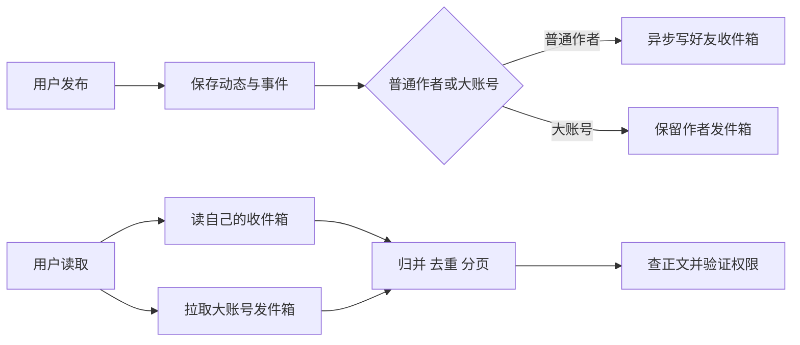

写扩散是**写一次、按读者人数写索引**：读取简单、延迟较低，但发布延迟、存储和热点账号扇出成本高；读扩散是**写一次、读取时聚合关注对象**：写入省，但读放大、合并成本高。推拉结合可以按粉丝规模和活跃度选择，并非所有朋友圈都需要“大 V”方案。用户关系变化时，旧收件箱要按当前权限过滤；新好友是否能看到历史动态由产品规则决定，可读取作者发件箱补齐或批量回填。扇出任务按 `post_id + owner_id` 幂等，分批处理、限速并监控积压。滚动分页要对多个来源使用一致的排序键并记录边界，过滤权限后若不足一页要继续拉取，直到填满或无更多数据。

**整体回答后可能沿着「扩散 → 数据修正 → 隐私」继续追问**：如果粉丝从 10 万增长到 100 万，单次扇出耗时如何控制？我会分批异步投递并限制单任务占用，超过阈值切换为读扩散；切换窗口允许双写，但读取按 `post_id` 去重，不能简单停掉原路径造成漏读。如何修复漏投？以权威发布事件及可重试任务记录对账、重放，超过保留期则按产品可接受范围重建；不能仅凭 MQ 已确认就断言所有收件箱完成。监控扇出延迟、失败率、索引存储量和 P99 读取延迟。

**面试官**：已经投递到好友收件箱，作者删除了动态怎么办？

**面试者**：先在正文权威库把状态改为删除，读时过滤；再异步清理收件箱和缓存。清理失败不影响权限正确性，重试或扫描修复。如果正文缓存可能陈旧，删除后可靠失效，并让权限校验不依赖旧缓存。

**面试官**：好友非常多时，读取怎么避免逐个查库？

**面试者**：普通账号预写收件箱，少数大账号才读扩散；对后者批量读取发件箱并做多路归并。大账号过多时读放大仍会明显，需要限制合并范围、缓存和压测，不能认为推拉结合没有成本。

### 2. 秒杀：名额预留与最终下单

**面试官想考察**：高并发削峰、库存和一人一单、跨 Redis/MQ/数据库的故障恢复、订单与支付竞争。考察重点是完整说明预扣成功但下单失败时如何收敛。

**面试者**：假设 1 万件商品、瞬时 10 万请求/秒、一人一单，订单创建成功才算抢购成功，允许用户看到排队中。先限流并用 Redis 减少数据库压力，但最终以数据库库存和订单为准。数据库唯一约束及条件更新负责兜底，Redis 不承担独立的最终正确性。

| 表或记录 | 关键字段与约束 | 用途 |
| --- | --- | --- |
| `activity_stock` | `activity_id PK, available, version` | 权威库存，`available >= 0` |
| `seckill_order` | `order_id PK, activity_id, user_id, status, expires_at`；`UK(activity_id, user_id)` | 一人一单及订单状态 |
| `reservation` | `request_id PK, activity_id, user_id, state, expires_at` | 可扫描的预留及恢复依据 |
| `outbox` | `event_id PK, aggregate_id, type, payload, status` | 本地事务提交后的可靠投递 |

```text
请求 -> 登录/风控/限流 -> Redis 原子预留 -> 排队结果
                               |                 |
                         可扫描预留记录      用户轮询结果
                               v
                         投递/补投任务 -> 消费者 -> 数据库事务：
                         唯一订单 + 条件扣库存 + 状态/事件 -> 成功或失败
```

Redis 脚本原子检查活动、库存、用户资格与请求 ID，记录预留及到期时间。预留成功后投递任务；投递失败由扫描器根据预留补投。消费者在事务里插入唯一订单并执行 `UPDATE activity_stock SET available=available-1 WHERE activity_id=? AND available>0`，检查受影响行数，失败则回滚。队列消费者用请求 ID 和唯一约束防重，用户通过请求 ID 查询最终结果。

#### 库表、容量与分片

补充 `activity(activity_id, sku_id, starts_at, ends_at, user_limit, status)` 管理规则，`inventory_reservation(request_id, activity_id, user_id, state, expires_at)` 保存可协调的预留状态，以及 `order_item(order_id, sku_id, price_fen)`、消费去重表 `processed_event(consumer, event_id)`。订单和预留量随活动增加，可按 `user_id` 或活动与用户组合分片；按用户分片便于查询我的订单及约束一人一单，活动级统计则需要异步汇总。数据库唯一约束必须包含路由键并落到同一分片，不能把单片唯一索引当全局唯一。单个活动库存行是热点，不能简单把同一件库存复制到多片；可先给各库存桶分配固定配额，所有桶配额总和不超过真实库存。

#### 主流程与核心权衡

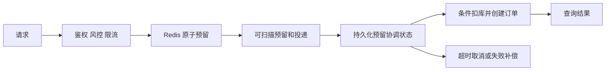

入口限流和 Redis 资格校验减少打到数据库的请求；MQ 限制消费速度，并不能创造下游处理能力，队列必须设置容量和过载拒绝策略。数据库最终条件扣库保证不超卖；订单成功才向用户显示成功。Redis 预留、持久化预留、投递之间存在多个失败窗口，必须在每一步有可扫描的记录和幂等补投。对“预留尚未持久化”的窗口，扫描器需以同一个请求 ID 补建持久状态；如果 Redis 丢失记录而又无其他持久证据，无法证明结果，需停流核对，不能靠猜测释放。

**整体回答后可能沿「削峰 → 幂等 → 补偿」追问**：限流后 MQ 仍堆积怎么办？按订单超时和消费能力设上限，拒绝新请求、扩容消费者到数据库瓶颈，再排查慢 SQL；不能无限排队。重复请求为什么不会多单？用户活动唯一键与请求 ID 双重约束。订单落库后消费者崩溃？重投读取同一订单结果，不能再次扣库。Redis 先扣后未发送？扫描补投；确实取消时由持久状态竞争决定谁胜出，再幂等恢复 Redis。

**面试官**：预留超时就给 Redis 加回库存，可以吗？

**面试者**：不能直接加。原消费者可能正在提交订单。我会让下单和取消竞争同一持久化预留状态：在同一数据库事务中条件领取预留、创建订单并标记成功；超时取消也先在数据库条件转为取消。只有确认取消胜出后才幂等恢复 Redis 名额。Redis 的释放和数据库状态仍跨系统，用可重试事件及周期校准修复；无法确认结果时先不释放，暂停或少卖优于超卖。若预留仅存在于 Redis，还需要在设计中补上这个持久协调步骤，不能只依赖查询后加库存。

**面试官**：Redis 故障切换丢了预留怎么办？

**面试者**：暂停入口，依据数据库订单、有效预留和活动总量核对、重建 Redis，再恢复接流；有未决任务时先处理或隔离。Redis 持久化和副本只能降低丢失概率，不能代替恢复方案。订单过期释放库存与支付结果的竞争还要按下文的关单状态机处理。

### 3. 支付：状态、账务和对账

**面试官想考察**：结果未知、幂等、回调安全、账务一致性与对账。核心是不能把超时当作支付失败，也不能把订单状态当成渠道实际资金状态。

**面试者**：假设我们对接外部支付渠道，支持支付和退款，不自行保存银行卡敏感信息。一个订单可有支付尝试，但每次尝试拥有稳定的支付单号；渠道超时后先查原支付单，不能创建新单盲目重试。账务记账以不可变流水为依据，修正使用冲正流水。

| 表 | 关键字段与约束 | 用途 |
| --- | --- | --- |
| `payment` | `payment_id PK, order_id, amount_fen, channel, status, channel_trade_no`；渠道流水唯一 | 支付意图和渠道结果 |
| `refund` | `refund_id PK, payment_id, amount_fen, status, channel_refund_no` | 每次退款的独立状态与幂等键 |
| `ledger_entry` | `entry_id PK, biz_type, biz_id, account_id, direction, amount_fen`；`UK(biz_type, biz_id, account_id, direction)` | 账务流水；复式记账还需记录对应分录 |
| `outbox` | `event_id PK, aggregate_id, type, payload, status` | 支付落账后通知订单 |

```text
创建支付单 -> 调渠道 -> 成功 / 失败 / 结果未知
                              |           |
                        验签回调或查单 <- 定时查询
                              v
                 条件推进支付状态 + 账务流水 + outbox（同库同事务）
                              v
                         消息通知订单 -> 幂等更新
```

金额使用整数分，服务端根据订单核对。回调先验签、校验商户、渠道流水、支付单号和金额，再按状态条件更新。对于同一业务事实，支付状态、账务流水和 outbox 必须在同一数据库事务中落地；如果账务属于独立服务，就不能声称本地事务覆盖两者，应使用可靠事件、幂等和对账保证最终收敛。退款创建时在锁定支付单或条件更新下约束 `已成功退款 + 处理中退款 <= 已支付金额`。

#### 库表、容量与分片

除支付单、退款单、流水外，至少还需要 `merchant(merchant_id, status, settlement_config)`、`payment_attempt(attempt_id, payment_id, channel_request_no, state)`、`channel_callback(callback_id, channel, external_event_id, verified, received_at)` 和 `reconciliation_diff(diff_id, bill_date, business_id, reason, status)`。回调表记录接收和处理状态，敏感原文按保留规则脱敏。支付单、流水与回调随交易增长；常见按商户或交易号路由，并建立订单号、渠道流水的可查询索引。按时间归档有利于清理历史，但单靠时间分片会让按支付单查找跨库；必须在 ID 或路由表中携带定位信息。跨分片唯一约束与账务事务是难点，不要假设数据库本地约束天然全局有效。

#### 主流程与核心权衡

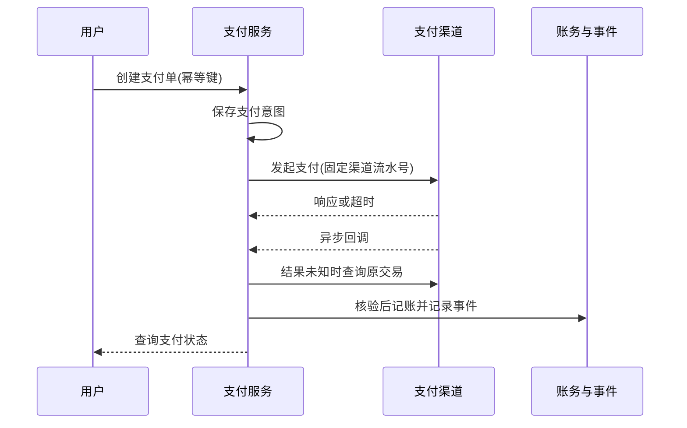

支付单的业务状态可设计为 `INIT → PROCESSING → SUCCESS/FAILED`，结果未知是处理中需要查询的子状态，状态迁移需按渠道语义定义。退款有独立单和状态机，不能把原支付单直接改为失败。账务最好使用成对分录和业务唯一键，确保每笔转移来源、去向均可追踪；退款额度并发预占后，明确失败释放与未知状态查询。每日对账将渠道账单和内部流水按交易号匹配，差异分为渠道成功内部无记录、内部成功渠道无记录、金额不符等，并记录处理闭环。

**整体回答后可能沿「超时 → 回调 → 资金核对」追问**：超时为何不能重新支付？因为渠道可能已扣款；先用原请求号查单。回调如何确保安全？按渠道协议验签、校验商户和金额，再进行幂等状态迁移。对账不是直接覆盖结果：渠道事实、账务和订单各自留痕，差异通过补单、退款或人工审核处理。

**面试官**：同步响应超时，回调也没来怎么办？

**面试者**：标记结果未知，使用原渠道交易号查询并有限退避重试；持续未知进入告警和人工处理。对账定时比对渠道账单、支付单与账务流水，分类处理漏单、金额差异和重复单。不能自动重复扣款。

**面试官**：回调重复或先于同步响应呢？

**面试者**：两条路径调用同一状态转换逻辑，唯一流水和条件更新确保只记一次账；后到的结果读取当前状态并返回已处理。冲突结果要查询渠道并告警，不能让终态随意倒退。

### 4. 二维码登录：跨设备授权

**面试官想考察**：状态机、认证与授权边界、一次性凭证、防重放和浏览器会话安全。

**面试者**：我假设手机已登录，浏览器是待登录设备。二维码只是临时场景标识，手机确认才代表授权；浏览器还要证明自己是创建该场景的设备，才能领取会话。

| 记录 | 关键字段 | 作用 |
| --- | --- | --- |
| `login_scene` | `scene_id PK, browser_secret_hash, status, user_id, expires_at, consumed_at` | 短期登录状态，可用支持原子操作和 TTL 的存储 |
| `session` | `session_id PK, user_id, device_info, expires_at, revoked_at` | 已登录设备会话 |

```text
浏览器创建场景 -> NEW -> 手机扫码 -> SCANNED -> 手机确认 -> CONFIRMED
                        |                  |                    |
                       过期              取消/过期          浏览器凭秘密兑换
                                                                v
                                                             CONSUMED
```

浏览器获取高熵 `sceneId` 和独立随机秘密，二维码只放前者；秘密只由创建场景的浏览器持有，服务端存哈希。手机已认证后扫码绑定账号，用户查看设备信息并确认。浏览器轮询或订阅状态，使用秘密兑换时，服务端原子校验未过期及 `CONFIRMED`，创建会话并将其置为已消费；若会话存储与场景存储不在同一事务内，要设计可重试的兑换结果和短期安全交付，不能在消费后丢失响应导致用户无法登录。

#### 库表、容量与分片

还需要 `user(user_id, status)` 和设备会话/审计 `session(session_id, user_id, device_id, expires_at, revoked_at)`。场景记录按随机 `scene_id` 分布到 Redis 集群并设短 TTL，容量约为每秒新建场景数 × 有效期 × 单条内存占用，加副本和元数据；稳定会话和登录审计按用户或时间分片归档。场景不能仅靠前端计时失效，服务端检查过期。删除账号、封禁或撤销会话需要单独的失效机制。

#### 主流程与核心权衡

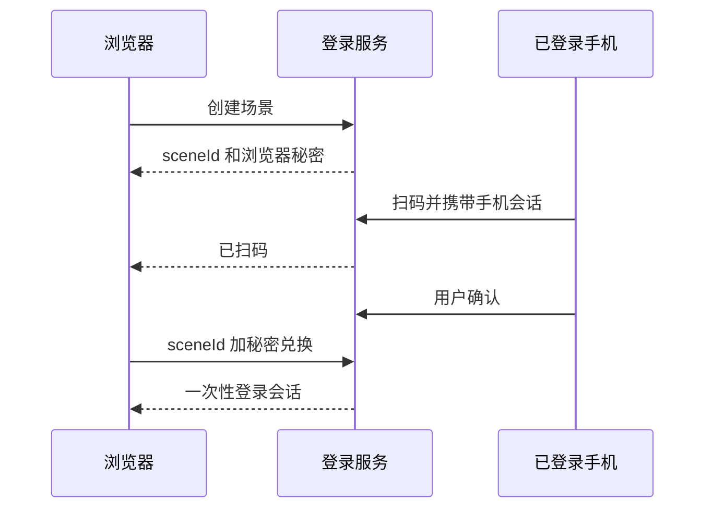

浏览器可以短轮询，或用 WebSocket/SSE 接收状态；连接只通知状态，不直接授予会话。场景存 `NEW/SCANNED/CONFIRMED/CONSUMED/EXPIRED`，状态变更原子校验前置状态、账号和时间。兑换成功后响应丢失时，应使用可恢复的短期兑换结果或幂等交付机制，并保持同一浏览器秘密绑定；不能让任何持有二维码的人获得会话。

**整体回答后可能沿「扫码 → 确认 → 兑换」追问**：扫码后为何还要手机确认？避免用户只扫了不可信二维码就授权登录。为何浏览器还需要秘密？二维码可能被旁观，场景 ID 本身不能证明浏览器身份。确认后用户又撤销或账号被封怎么办？兑换前复查用户状态，已签发会话则走撤销机制；审计中记录设备、时间和风险信息。

**面试官**：别人拍到二维码能登录吗？

**面试者**：他可以尝试扫码，但不能仅凭 `sceneId` 兑换浏览器会话；手机端必须提示用户确认设备和风险。浏览器秘密、短有效期、HTTPS 和一次性消费降低抢兑与重放风险，但仍要防止诱导用户确认陌生设备。

**面试官**：用户一直不操作怎么办？

**面试者**：服务端按过期时间拒绝所有状态转换并清理记录，前端显示过期并重新生成；轮询限频，状态查询不泄露会话凭证。

### 5. 短链接：映射与跳转

**面试官想考察**：唯一 ID、读写比例、重定向缓存、滥用治理与可扩展性。

**面试者**：假设每天新增 100 万短链、访问 1 亿次，平均读约 1157 QPS，峰值另按业务系数估计；主要优化跳转读路径。短码映射持久化，缓存只是加速层。

| 表 | 关键字段与约束 | 用途 |
| --- | --- | --- |
| `short_link` | `code PK, long_url, owner_id, status, expires_at, created_at` | 短码映射及有效期 |
| `visit_event` | `event_id PK, code, visited_at, source` | 异步统计事件，可进入分析存储 |

```text
创建：校验 URL -> 生成 ID / Base62 -> 唯一插入映射 -> 返回短链
跳转：短码 -> 缓存 -> 未命中查库 -> 校验状态和过期 -> 302 到目标
                                          -> 异步统计
```

生成 ID 可采用号段服务再转 Base62；短码长度随编号增长，编号可能暴露规模。若采用随机码，则依靠唯一索引检测碰撞并重试。编辑、禁用后可靠删除缓存并设置 TTL。查询不存在的码时短暂缓存空值并限制请求，降低穿透。

#### 库表、容量与分片

补充 `link_owner(owner_id, quota, status)`、`link_alias(code, link_id, status)` 和事件去重或统计表 `visit_event(event_id, code, visited_at, ...)`。假设每天 100 万条、保留 3 年，约 10.95 亿条映射；平均每条有效数据和索引按 500 字节估算约 548 GB，尚未包含副本、存储膨胀和访问日志。映射以 `code` 哈希路由可均衡跳转，但按创建者列出短链需 `(owner_id, link_id, code)` 的辅助索引，异步维护会有延迟。日志通常量更大，可按日期分区并进入分析存储，过期归档。

#### 主流程与核心权衡

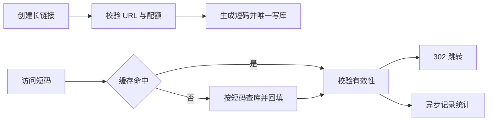

全局号段分配可以减少逐请求协调，但要考虑号段浪费及服务故障；随机码需以唯一约束为准处理碰撞。更新目标后删除缓存，浏览器/中间代理对重定向的缓存规则也影响变更生效时间。拒绝危险协议，必要时对目标做信誉检查；预览服务抓取目标时应防止访问内网和重定向绕过校验。

**整体回答后可能沿「生成 → 跳转 → 统计」追问**：短码冲突怎么办？唯一索引失败即换码重试，并限制重试次数。热点短链怎么办？合理 TTL 的本地或 CDN 缓存配合失效，但要接受更新传播延迟。统计日志丢失是否影响跳转？如果统计允许近似，可隔离主链路并采样；如果用于结算，则需要可靠落地、幂等和对账。

**面试官**：为什么选择 302？

**面试者**：假设目标可能更新、访问需要统计，302 更符合需求；301 可能被浏览器或中间缓存长期记住，减少服务端请求但撤销和统计更难。实际缓存行为还要考虑响应头。

**面试官**：缓存和数据库都被随机短码打满怎么办？

**面试者**：入口限流、空值短 TTL、容量隔离，必要时使用可更新的布隆过滤器；过滤器构建或更新滞后时不能错误屏蔽新短链，需回退查库或保证发布顺序。

### 6. 超时订单：关闭与支付竞态

**面试官想考察**：状态机、条件更新、延迟消息的可靠性、第三方支付和本地订单之间的边界。

**面试者**：假设订单 15 分钟未支付则关闭并释放库存。延迟消息只是触发器，数据库状态和支付渠道结果才是决策依据；我会把订单关闭与库存释放事件放在同一个本地事务内。

| 表 | 关键字段与约束 | 用途 |
| --- | --- | --- |
| `orders` | `order_id PK, user_id, status, amount_fen, expires_at, version` | 订单状态及截止时间 |
| `inventory` | `sku_id PK, available, reserved` | 库存；若独立服务则通过事件处理 |
| `outbox` | `event_id PK, order_id, type, status` | 关单后的库存释放事件 |

```text
创建订单 -> 待支付 -> 支付确认 -> 已支付
                   -> 超时关单 -> 已关闭 -> 释放库存
支付渠道已成功但本地已关闭 -> 退款或人工补偿，不直接丢弃支付结果
```

定时消息到达后先核查订单与截止时间；对正在支付或结果未知的交易查询渠道，不能仅依据本地超时判断未支付。确认可关闭后条件更新订单并写 outbox；库存服务以订单 ID 去重释放。定期扫描超时未关闭订单与未投递事件，补偿延迟消息丢失或积压。

#### 库表、容量与分片

除订单、库存、outbox，还需要 `order_item(order_id, sku_id, quantity, price_fen)`、`payment_attempt(payment_id, order_id, channel_status)`、`inventory_reservation(order_id, sku_id, quantity, status)` 和 `close_task(order_id, due_at, status, attempt)`。订单和明细按 `user_id` 或订单号路由，查询用户订单时尽量带路由键；按到期时间扫描则需分片内 `(status, expires_at)` 索引或独立任务索引。拆分订单与库存为不同服务时不能声称关单和释放库存处于同一个本地事务，需以 outbox 驱动预留状态幂等释放。

#### 主流程与核心权衡

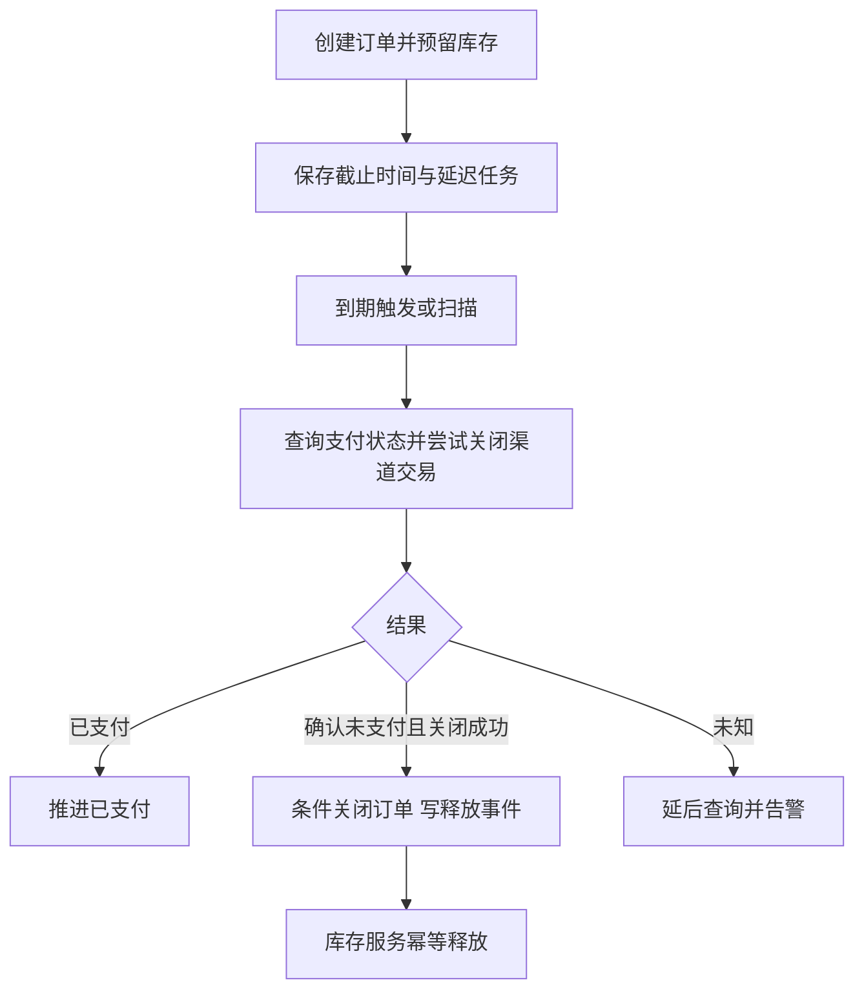

延迟队列降低扫描成本，周期扫描提供兜底；扫描须分片、分页并限制速率。订单状态与渠道状态是两个状态机，渠道关单接口若无法给出确定结果，则保留未知状态并查询，不宜释放库存后再假定绝无支付成功。

**整体回答后可能沿「延迟消息 → 竞争 → 退款」追问**：消息重复？条件更新和释放记录唯一键防止重复释放。消息丢失？数据库到期扫描补偿。渠道晚到成功？记录支付事实，按明确规则退款或人工处理；若订单已释放库存，重新履约需重新校验库存，不能直接标记已完成。

**面试官**：支付成功回调和关单同时到达怎么办？

**面试者**：本地状态转换通过条件更新竞争；但这只能协调本地状态，不能撤销渠道已经发生的扣款。关单应先按渠道能力关闭支付交易并查询最终结果；如果仍发生晚到成功，记录异常并按规则退款或人工处理，库存是否需要重新预留也要明确。

### 7. 红包与抽奖：守恒和防重复

**面试官想考察**：资金或奖品守恒、并发扣减、随机分配、幂等和过期补偿。

**面试者**：先设计固定总额、固定份数的普通红包，每人一次，过期退还余额。钱以分为单位；红包创建前确认资金已冻结或转入红包账户，任何领取都要有可对账的流水。

| 表 | 关键字段与约束 | 用途 |
| --- | --- | --- |
| `red_packet` | `packet_id PK, total_fen, remaining_fen, total_count, remaining_count, status, expires_at` | 剩余金额和份数 |
| `claim` | `claim_id PK, packet_id, user_id, amount_fen, status`；`UK(packet_id, user_id)` | 领取记录及幂等 |
| `ledger_entry` | `entry_id PK, biz_id, account_id, direction, amount_fen` | 资金划转和退款流水 |

```text
创建并冻结资金 -> 领取请求 -> 去重 + 锁定/条件更新红包余额 -> 写领取及流水
                                                    -> 过期关闭 -> 退还剩余金额
```

在同库事务内锁定红包行，判断状态、截止时间、剩余份数和余额，计算金额并更新，同时插入唯一领取记录和账务分录。抽取金额保证剩余每份至少一分，最后一份取剩余金额；分布是否公平需根据规则设计和模拟验证。独立账务服务时，领取与入账通过可靠事件衔接，状态显示处理中并对账补偿。

#### 库表、容量与分片

除红包、领取和流水，还需 `account(account_id, balance_fen, version)`、`refund(refund_id, packet_id, amount_fen, status)`；抽奖还需 `prize(prize_id, activity_id, remaining)`、`draw_result(draw_id, activity_id, user_id, prize_id)`、`grant_task(draw_id, status)`。领取表按 `packet_id` 路由有利于保证红包内领取唯一性，但超热门红包集中在一个分片；按用户路由有利于查历史，却需要另一套按红包查询的索引。领取明细和流水按保留期归档，账务保留要求应根据实际业务确定。预拆红包金额或分桶能缓解热点，但总配额必须守恒，未领完也要归集退还。

#### 主流程与核心权衡

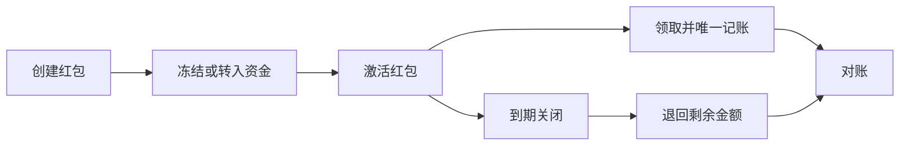

在同一账务库内事务完成扣减、领取与分录最容易解释；跨服务时需要冻结、领取、入账及退款各自有明确状态和幂等键。分配算法在计算本次金额时必须保留剩余份数的最低金额，且总额不足份数时拒绝创建。抽奖的概率规则、奖池不足和风控需要单独声明；概率并不等于库存一定充足。

**整体回答后可能沿「随机 → 并发 → 退回」追问**：随机算法如何验证？检查总额守恒、最低金额和边界，再通过大量模拟分析分布，是否公平由产品定义。重复点击如何保证只领一次？联合唯一键及稳定请求 ID。过期与领取同时发生？红包状态和余额在同一权威事务内竞争，退款流水用独立幂等键。

**面试官**：怎么证明金额没有凭空出现？

**面试者**：对每个红包核对 `总额 = 成功领取总额 + 已退款额 + 当前剩余`；统计时区分正在处理的冻结金额，账务流水和红包状态也要对账。重复领取由唯一键阻止，过期退款使用独立业务键幂等。

**面试官**：换成抽奖还需要什么？

**面试者**：增加活动、奖品库存、中奖记录和发奖任务；服务端确定结果并持久化，奖品库存条件更新，发奖任务按中奖 ID 幂等。概率规则、保底和奖品不足时的行为都要先明确。

### 8. 消息通知 / IM：可靠投递与顺序

**面试官想考察**：长连接、消息持久化、离线同步、顺序和去重。先说明送达语义，避免承诺全局有序或绝不重复。

**面试者**：假设先做单聊文本，消息允许至少一次投递；同一会话内按服务端分配的序号排序，不要求跨会话全局有序。

| 表 | 关键字段与约束 | 用途 |
| --- | --- | --- |
| `conversation` | `conversation_id PK, member_a, member_b, next_seq` | 会话和序号分配 |
| `message` | `message_id PK, conversation_id, seq, sender_id, client_msg_id, body`；`UK(sender_id, client_msg_id)`、`UK(conversation_id, seq)` | 正文、幂等及会话顺序 |
| `user_cursor` | `user_id, device_id, conversation_id, ack_seq`；联合唯一 | 各设备确认进度 |

```text
发送端 -> 鉴权/成员校验 -> 持久化消息和投递事件 -> 返回消息 ID
                                            -> 在线网关推送 -> 客户端 ACK
接收端重连 -> 按会话游标拉取缺失消息 -> 按 message_id 去重并按 seq 排序
```

网关维护用户设备到连接节点的临时路由，路由不是消息权威存储。消息在会话内分配序号后持久化，投递失败重试；客户端按消息 ID 去重。ACK 应表示连续收到的序号，不能用最大已见序号直接跳过中间缺口；多设备分别保存游标。

#### 库表、容量与分片

补充 `conversation_member(conversation_id, user_id, role, joined_at)`、`message_delivery(message_id, device_id, status)` 和 `outbox(event_id, conversation_id, seq, status)`。消息按 `conversation_id` 路由便于顺序读取，容量随消息和保留时间增长；可按会话及时间分区，冷消息归档。大群会导致单会话热点及投递放大，需要分段存储、分批投递和读扩散等策略；不能仅增加哈希分片就承诺单会话顺序不变。游标按用户和设备保存，消息正文、附件分别放数据库和对象存储。

#### 主流程与核心权衡

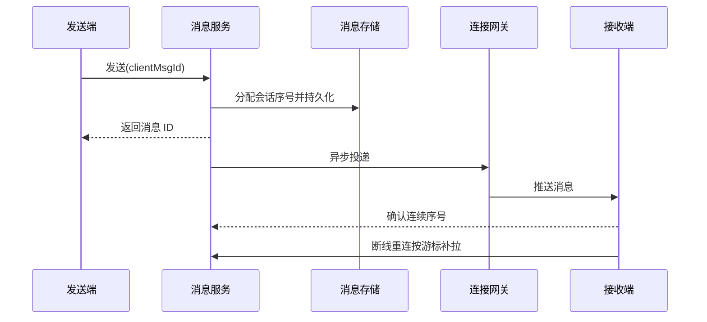

会话序号分配要与消息持久化的提交顺序一致，避免序号已分配却永久缺失造成连续 ACK 卡住；可由单会话串行写入或明确空洞/跳过协议。客户端 ACK 只表明该设备收到，不等于用户已读。投递路由失效时回退到离线拉取，消息保留期外需告知无法完整恢复。

**整体回答后可能沿「持久化 → 顺序 → 多端」追问**：先推送再落库为什么危险？服务崩溃可能导致接收端看到了无法恢复的消息。重复消息如何处理？发送端幂等键及接收端消息 ID 去重。多端游标如何设计？每设备独立连续 ACK，已读状态按产品规则单独聚合。

**面试官**：消息保存成功但发送端没收到响应怎么办？

**面试者**：客户端用相同 `client_msg_id` 重试，服务端唯一约束返回已有消息。用户撤回、离线保留期限和已读回执需要独立业务规则和状态，不能仅依赖 TCP 连接成功。

### 9. 排行榜与计数器：实时性与精度

**面试官想考察**：热点写入、聚合、重复事件、榜单排序和权威数据重建。

**面试者**：假设是每日积分榜，允许数秒延迟但不能重复计分；每个计分事件有稳定业务 ID。原始事件及用户当日积分为权威数据，Redis 榜单是可重建的读模型。

| 表 | 关键字段与约束 | 用途 |
| --- | --- | --- |
| `score_event` | `event_id PK, user_id, day, delta, occurred_at` | 去重及重放依据 |
| `daily_score` | `day, user_id, score, version`；联合主键 | 持久化的每日汇总 |
| Redis ZSet | `key=rank:{day}`，成员为用户，分值为积分 | 查询排名与区间 |

```text
积分事件 -> 按 event_id 去重 -> 更新每日汇总 + outbox（同事务）
                                      -> 消费事件更新榜单 -> 排名查询
                                      -> 定期比对/重建
```

消费事件时避免对重复消息直接 `ZINCRBY`：可按用户和日期串行应用带版本的绝对分数，并忽略旧版本；重建时要处理快照与增量的交接。对于同分，明确按先达到分数时间或用户 ID 排序，Redis 的默认同分字典序未必符合规则，可能需要额外排序设计。

#### 库表、容量与分片

补充 `ranking_definition(rank_id, period, rule, tie_break)` 和 `score_event(event_id, rank_id, user_id, delta, occurred_at)`，`daily_score` 存汇总及版本。原始事件按时间分区便于归档，按用户和日期路由汇总便于幂等更新；查询全局榜通过 Redis 读模型或分析系统。单个大榜不能无条件放进一个无限增长的 ZSet，应设周期、保留期和容量预算；可按用户分桶并查询各桶前 K 再归并，但实时精确名次、深分页和跨桶更新更复杂。

#### 主流程与核心权衡

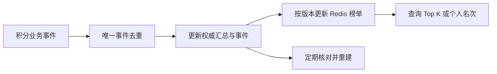

ZSet 中双精度分数的整数精度有限，不宜随意把积分、时间和 ID 打包为一个超大浮点数。相同分数的业务排序规则要单独建模。对单热点计数可把写入按稳定事件键分片并异步求和，但如果源事件未可靠保存，实例故障可能永久丢数。

**整体回答后可能沿「实时性 → 去重 → 重建」追问**：为什么不直接对每条消息 `ZINCRBY`？重复投递会重复加分。重建期间新分数怎么办？用数据库一致快照及可靠变更位点构建新榜，追平增量后原子切换，处理乱序和重复。榜单和数据库不一致？报警、按版本修复或重建，不能盲目覆盖更新中的新值。

**面试官**：单个热点计数器写得太快怎么办？

**面试者**：对于允许延迟的浏览量，把事件分片计数并异步汇总，说明丢失、重复和重放的恢复机制；库存、余额等不适合用可能丢失的近似计数作为权威值。分片会让实时读取及去重更复杂。

### 10. 分布式任务调度：触发与执行分离

**面试官想考察**：多节点协调、租约失效、重复执行、补跑策略和可观测性。

**面试者**：假设要执行定时对账任务，允许重试但业务必须幂等。调度器负责创建执行实例，执行器负责领取和执行；不承诺仅执行一次，而是通过业务幂等让重复执行安全。

| 表 | 关键字段与约束 | 用途 |
| --- | --- | --- |
| `job` | `job_id PK, cron, enabled, next_fire_at, timeout_sec` | 调度配置 |
| `job_run` | `run_id PK, job_id, scheduled_at, status, lease_owner, lease_until, attempt`；`UK(job_id, scheduled_at)` | 一次计划触发及租约 |
| `job_attempt` | `attempt_id PK, run_id, worker_id, started_at, ended_at, result` | 执行记录 |

```text
调度器扫描到期任务 -> 唯一插入 job_run -> 执行器条件领取租约
                                               -> 执行/续租 -> 成功
                                               -> 超时/失败 -> 有限重试或告警
```

多调度器可以同时扫描，通过唯一约束避免重复创建同一次计划实例；领取时原子检查待执行或租约已过期，并设置 owner、截止时间和递增版本。执行器完成时带版本更新状态，避免旧执行者覆盖新结果。租约无法阻止失联的旧执行者继续操作外部系统，业务必须幂等；需要严格排斥旧写入时，受控资源也必须校验递增 fencing token。

#### 库表、容量与分片

补充 `job_definition(job_id, cron, timezone, concurrency_policy, misfire_policy, enabled)`、`job_run` 和 `job_attempt`，以及调度器租约或分片归属记录。执行历史通常比任务定义增长快，可按时间分区归档；`job_run` 需 `(job_id, scheduled_at)` 唯一约束和 `(status, next_retry_at)` 领取索引。如果按时间切分，唯一键和路由规则要保证同一触发时间不会落到不同分片。任务所在时区、夏令时和 cron 边界须明确。

#### 主流程与核心权衡

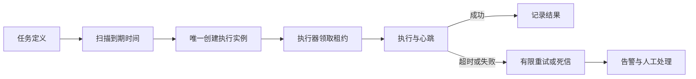

创建执行实例与推进 `next_fire_at` 要在同一事务中完成，或有可证明的恢复协议，防止崩溃漏触发。领取使用数据库时间和租约版本；同一任务是否允许并行、补跑次数和重试间隔都是配置项。任务处理外部副作用时用 `run_id` 作为业务幂等键，旧租约的写入还需要目标资源校验 fencing token。

**整体回答后可能沿「触发 → 租约 → 幂等」追问**：调度器宕机后怎么补？根据持久化的下一触发时间与 misfire 策略恢复。执行器卡顿导致租约到期而继续执行？新旧执行可能并存，不能仅靠租约保证互斥；必须由业务幂等或资源端拒绝旧 token。失败无限重试会怎样？会造成重试风暴，应退避、限制次数并告警。

**面试官**：系统停机两小时，恢复后错过的任务怎么办？

**面试者**：每个任务配置跳过、补跑一次或逐次补跑，并设置最大补跑数量和速率；对账任务可能需要按日期逐次补跑。监控计划时间与实际启动时间之差、失败和租约过期数量。

### 11. 缓存与数据库一致性：明确一致性窗口

**面试官想考察**：旁路缓存的并发竞态、缓存失效可靠性、穿透击穿雪崩，以及一致性目标和性能取舍。

**面试者**：假设商品详情读多写少，允许秒级短暂旧数据，但库存和支付决策必须读取权威状态。我采用旁路缓存和短 TTL，先提交数据库再删除缓存，并通过可靠事件修复删除失败。

| 数据 | 关键字段 | 用途 |
| --- | --- | --- |
| `product` | `product_id PK, name, price_fen, status, version` | 权威商品数据及版本 |
| `outbox` | `event_id PK, product_id, version, type, status` | 重试缓存失效或刷新 |
| Redis 商品缓存 | `product:{id}` -> 详情、版本、TTL | 加速查询，非权威数据 |

```text
写：更新 product + outbox（事务提交） -> 删除缓存 -> 失败则重试
读：查缓存 -> 未命中查数据库 -> 回填缓存 -> 返回
```

#### 库表、容量与分片

除 `product`、`outbox`，可以有 `product_version(product_id, version)` 或将版本放在商品行；缓存里保存 `product_id, version, value, expires_at`。商品按 `product_id` 路由；outbox 与对应商品位于同一数据库事务边界，按发送状态和时间索引、定期归档。缓存容量按热点商品数 × 序列化大小，加 key、元数据、副本和内存碎片估算；缓存淘汰只影响性能，不能当成权威删除。跨服务商品索引和变更订阅需要各自记录消费位点与恢复策略。

#### 主流程与核心权衡

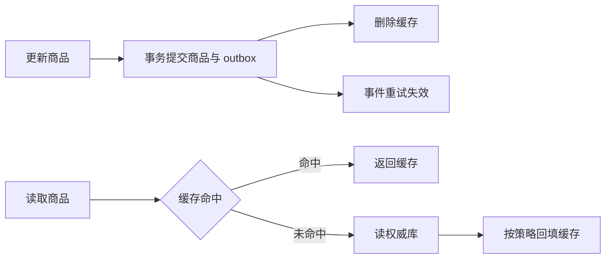

缓存失效不等于所有并发回填都安全：旧读可能在删除后写回。若引入版本栅栏，写入与版本比较必须在同一原子边界内完成，并考虑栅栏丢失、过期和数据库提交与发布之间的窗口；只在值中附带版本并不能自动避免旧值。对价格展示可接受短暂滞后，对提交订单时的价格和库存必须重新校验权威值。

**整体回答后可能沿「缓存失效 → 竞态 → 保护数据库」追问**：为什么先更新再删除？先删除后更新期间，读者可能把旧库值重新填入缓存。更新后删除为什么仍有问题？并发旧读和删除失败仍会产生不一致。怎么评估方案？用可接受过期窗口、失效失败数、回源 QPS、重建锁等待和 P99 延迟一起衡量。

**面试官**：先更新数据库再删缓存，是否一定一致？

**面试者**：不一定。读请求可能在更新前读到旧值，却在删除后才回填旧缓存；删除也可能失败。短 TTL 限制旧值持续时间，可靠失效事件修复失败；更严格时需设计版本校验、原子回填协议或直接读取满足一致性要求的权威库，并说明协议本身的故障边界。延迟双删只能降低概率，不能证明强一致。

**面试官**：缓存失效后大量请求打到数据库怎么办？

**面试者**：热点重建使用互斥或 single-flight，并设置限流和超时；不存在的数据短暂缓存空值，TTL 打散降低集中失效。锁持有者故障时要有超时与回退，数据库也要有容量保护。


## 四、面试前自查

- 是否说清楚了范围、数量级、延迟目标和关键业务不变量？
- 是否能用一条成功请求解释关键表、接口、状态及权威数据源？
- 超时结果未知、重复、乱序、并发和宕机时，如何判断结果并恢复？
- 方案是否有明确的唯一键、原子边界、幂等和补偿？缓存或 MQ 故障会怎样？
- 是否说出了替代方案、成本、监控指标和验证方式？不会的部分是否明确说明假设？

## 五、资料与延伸阅读

以下公开资料用于识别题目方向；具体设计为本文归纳，面经内容和频率不应视为权威统计。

- [牛客：系统架构高频面试真题统计](https://www.nowcoder.com/discuss/788009237426212864?sourceSSR=dynamic)：缓存一致性、限流和秒杀等。
- [牛客：后端高频面试题汇总](https://www.nowcoder.com/discuss/889150185626955776?sourceSSR=enterprise)：秒杀、抢红包、超时关单、MQ 和一致性追问。
- [牛客：美团场景题整理](https://www.nowcoder.com/discuss/733365340561772544)：缓存、计数器、支付、登录、抽奖和排行榜方向。
- [牛客：分布式任务调度系统](https://www.nowcoder.com/discuss/830830870373093376)：调度场景入口。
- [牛客：系统设计高频题与思路](https://www.nowcoder.com/discuss/908776853492535296)：短链接设计与工程权衡。
- [牛客：试题广场](https://www.nowcoder.com/questionCenter?mutiTagIds=622_626_627_628_629&onlyReference=false&orderByHotValue=0&page=13)：Feed 等开放式系统设计题。
